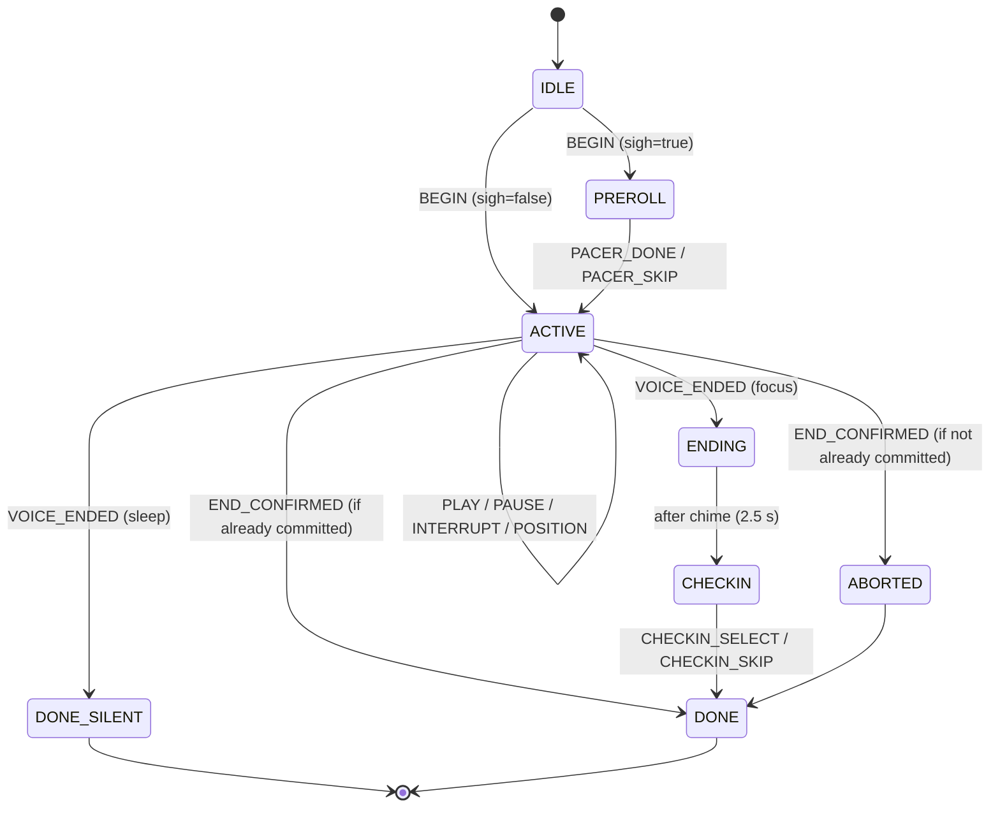

---

## 3. Retention & Gamification State Machine

Philosophy: **the app absorbs the cost of imperfection so the user never has to.** Every rule below is deterministic, pure (no I/O), and unit-tested with the vectors given. All domain logic lives in `src/domain/` and never imports React, SQLite, or Expo.

### 3.1 Domain Modules

| File | Responsibility |
|---|---|
| `src/domain/constants.ts` | All tunable numbers (§3.2) |
| `src/domain/clock.ts` | `Clock` interface (`now(): number`), `SystemClock`, `DevClock` (offset in days, used by the Dev Panel) |
| `src/domain/dayKey.ts` | `dayKeyFromMs(ms)`, `addDays`, `daysBetween` |
| `src/domain/streakEngine.ts` | `applyCredit`, `projectStreak`, `qualifiesForFreePass` |
| `src/domain/sessionMachine.ts` | Pure reducer for session lifecycle + effects (§3.4) |
| `src/domain/calmDelta.ts` | Insight computation (§3.8) |
| `src/domain/timeOfDay.ts` | `defaultProtocol(now)`, `greeting(now)` (§3.7) |
| `src/domain/notificationPlanner.ts` | `planNextNotification(input)` (§3.6) |

### 3.2 `constants.ts` (single source of truth)

```ts
export const PROTOCOL_IDS = ['rapid_reset_5', 'afternoon_recharge_10', 'deep_rest_30'] as const;
export type ProtocolId = (typeof PROTOCOL_IDS)[number];

export const PLANNED_MS: Record<ProtocolId, number> = {
  rapid_reset_5: 300_000,
  afternoon_recharge_10: 600_000,
  deep_rest_30: 1_800_000,
};

// Commit (streak-credit) thresholds as a fraction of planned duration
export const COMMIT_THRESHOLD = { focus: 0.90, sleep: 0.85 } as const;
export const PARTIAL_MIN_LISTENED_MS = 120_000;     // below this an early exit is 'abandoned'

// Grace ("Rest Grace")
export const GRACE_EVERY_N_DAYS = 5;
export const GRACE_MAX_BANKED = 2;

// Free pass ("3-Day Streak Taste")
export const FREE_PASS_STREAK_DAYS = 3;
export const FREE_PASS_VALID_DAYS = 14;
export const FREE_PASS_CONSUME_AT = 0.20;           // fraction of the 30-min session
export const FREE_PASS_MAX_LIFETIME = 1;

// Sleep mode
export const SLEEP_FADE_MS = 90_000;
export const SLEEP_RECONCILE_MIN_PROGRESS = 0.50;   // heartbeat must have shown >= 50% progress
export const MORNING_CHECKIN_WINDOW_MS = 10 * 3_600_000;

// Insights
export const CALM_DELTA_MIN_SAMPLES = 5;

// Notifications
export const QUIET_START_MIN = 22 * 60 + 30;        // 22:30
export const QUIET_END_MIN = 7 * 60 + 30;           // 07:30
export const DEFAULT_REMINDER_MIN = 14 * 60 + 15;   // 14:15 (afternoon dip)
export const WIND_DOWN_MIN = 21 * 60 + 30;          // 21:30
export const LAPSED_NUDGE_AFTER_DAYS = [3, 7] as const; // then silence

// Recovery scale used by check-ins
export const STATE = { WIRED: 1, DRAINED: 2, NEUTRAL: 3, CALM: 4, RESTORED: 5 } as const;
```

### 3.3 Streak Rules (exact)

**Vocabulary.** *Practice day* = a local calendar day containing ≥ 1 **committed** session (any protocol, any access path). *Credit day* = the practice day to which a session is attributed. *Rest Grace* = banked forgiveness for missed days.

**R1 — Day attribution (local midnight handling).**
`credit_day = local calendar date of the session's START time`, computed once from device local time and stored as `session_logs.local_day` (`YYYY-MM-DD`) together with `tz_offset_min`. The streak engine only ever compares stored `YYYY-MM-DD` strings; it never re-derives days from UTC afterwards.

| Edge case | Result |
|---|---|
| Sleep session starts 23:50, hits 85 % at 00:15 | Credited to the day it **started** (23:50's date). The user is never penalized for falling asleep across midnight. |
| Two sessions on one day | Streak increments once; minutes accumulate in `day_ledger`. |
| Session starts 00:10 | Credited to the new calendar day. |
| User changes time zone (travel) | History is immutable (stored strings). A westward flight can produce a repeated date → idempotent. An eastward flight can skip a date → handled as a normal missed day (Grace may cover it). |
| Device clock set backward (`today < lastCreditDay`) | `daysBetween ≤ 0` → treated as "already credited"; streak never decreases from clock manipulation. |
| DST transitions | Irrelevant: day math uses calendar components via `Date.UTC(y, m-1, d)`, never `ms / 86_400_000` on local times. |
| Leap years / month ends | `2026-02-28 → 2026-03-01` is gap 1; `2028-02-28 → 2028-03-01` is gap 2. |

**R2 — Credit application** (`applyCredit(state, today)`), executed exactly once when a session commits:

```
if lastCreditDay != null and daysBetween(lastCreditDay, today) <= 0: return unchanged
if lastCreditDay == null:                  streak = 1
else gap = daysBetween(lastCreditDay, today); missed = gap - 1
     if missed == 0:                       streak += 1
     elif missed <= graceBanked:           graceBanked -= missed; graceUsedTotal += missed
                                           coveredDays = [lastCreditDay+1 .. lastCreditDay+missed]
                                           streak += 1            # grace bridges days; it does NOT add to the count
     else:                                 streak = 1 (soft reset); graceProgress = 0
                                           graceBanked is KEPT (we never take Grace for a streak that already ended)
graceProgress += 1                          # only practice days earn progress
while graceProgress >= 5 and graceBanked < 2: graceBanked += 1; graceProgress -= 5; graceEarnedTotal += 1
if graceProgress > 5: graceProgress = 5     # progress is held (not lost) while the bank is full
longestStreak = max(longestStreak, streak); lastCreditDay = today
```

**R3 — Grace earning:** every 5 *practice* days (counter `graceProgress`) banks 1 Grace Day; **max 2 banked**. Progress is *held* at 5 while full, so the next consumed Grace is immediately replaced on the next practice day.

**R4 — Grace consumption:** automatic, retroactive, at the next commit. Max coverable gap is 2 missed days (because max bank is 2). Grace-covered days are written to `day_ledger` with `kind='grace'` and render as ringed cells in the heatmap.

**R5 — Display projection** (`projectStreak(state, today)`) — what the pill shows *before* the user practices today; pure and never mutates state:

| Condition | `status` | Displayed streak | Pill / copy |
|---|---|---|---|
| `lastCreditDay == null` | `fresh` | 0 | Empty ring |
| `daysBetween ≤ 0` | `done_today` | current | Full glow |
| gap = 1 | `open` | current | Soft glow; no warning |
| gap ≥ 2 and `gap-1 ≤ graceBanked` | `held_by_grace` | current | 60 % glow; Journey line: "Rest Grace is holding your streak." |
| gap ≥ 2 and `gap-1 > graceBanked` | `lapsed` | 0 | Empty ring; Journey line: "Begin again — your best was N." (no red, no loss language elsewhere) |

**Reference implementation** (`src/domain/streakEngine.ts`; the implementing agent must reproduce this behavior exactly):

```ts
import { GRACE_EVERY_N_DAYS, GRACE_MAX_BANKED, FREE_PASS_STREAK_DAYS } from './constants';
import { addDays, daysBetween, type DayKey } from './dayKey';

export interface StreakState {
  currentStreak: number; longestStreak: number; lastCreditDay: DayKey | null;
  graceBanked: number; graceProgress: number;      // 0..5
  graceEarnedTotal: number; graceUsedTotal: number;
}
export const INITIAL_STREAK: StreakState = {
  currentStreak: 0, longestStreak: 0, lastCreditDay: null,
  graceBanked: 0, graceProgress: 0, graceEarnedTotal: 0, graceUsedTotal: 0,
};
export interface CreditResult {
  next: StreakState; changed: boolean; coveredDays: DayKey[];
  graceEarned: number; reset: boolean;
}

export function applyCredit(s: StreakState, today: DayKey): CreditResult {
  if (s.lastCreditDay !== null && daysBetween(s.lastCreditDay, today) <= 0) {
    return { next: s, changed: false, coveredDays: [], graceEarned: 0, reset: false };
  }
  const n: StreakState = { ...s };
  const covered: DayKey[] = [];
  let reset = false;
  if (s.lastCreditDay === null) {
    n.currentStreak = 1;
  } else {
    const missed = daysBetween(s.lastCreditDay, today) - 1;
    if (missed === 0) n.currentStreak = s.currentStreak + 1;
    else if (missed <= s.graceBanked) {
      n.graceBanked -= missed; n.graceUsedTotal += missed;
      for (let i = 1; i <= missed; i++) covered.push(addDays(s.lastCreditDay, i));
      n.currentStreak = s.currentStreak + 1;
    } else { n.currentStreak = 1; n.graceProgress = 0; reset = true; }
  }
  n.graceProgress += 1;
  let earned = 0;
  while (n.graceProgress >= GRACE_EVERY_N_DAYS && n.graceBanked < GRACE_MAX_BANKED) {
    n.graceBanked += 1; n.graceProgress -= GRACE_EVERY_N_DAYS; n.graceEarnedTotal += 1; earned += 1;
  }
  if (n.graceProgress > GRACE_EVERY_N_DAYS) n.graceProgress = GRACE_EVERY_N_DAYS;
  n.longestStreak = Math.max(s.longestStreak, n.currentStreak);
  n.lastCreditDay = today;
  return { next: n, changed: true, coveredDays: covered, graceEarned: earned, reset };
}

export type StreakStatus = 'fresh' | 'done_today' | 'open' | 'held_by_grace' | 'lapsed';
export function projectStreak(s: StreakState, today: DayKey) {
  if (s.lastCreditDay === null) return { status: 'fresh' as StreakStatus, display: 0, graceWillCover: 0 };
  const gap = daysBetween(s.lastCreditDay, today);
  if (gap <= 0) return { status: 'done_today' as StreakStatus, display: s.currentStreak, graceWillCover: 0 };
  if (gap === 1) return { status: 'open' as StreakStatus, display: s.currentStreak, graceWillCover: 0 };
  const missed = gap - 1;
  return missed <= s.graceBanked
    ? { status: 'held_by_grace' as StreakStatus, display: s.currentStreak, graceWillCover: missed }
    : { status: 'lapsed' as StreakStatus, display: 0, graceWillCover: 0 };
}

export function qualifiesForFreePass(daysWithShortSession: ReadonlySet<DayKey>, today: DayKey): boolean {
  for (let i = 0; i < FREE_PASS_STREAK_DAYS; i++) if (!daysWithShortSession.has(addDays(today, -i))) return false;
  return true;
}
```

`dayKey.ts`:

```ts
export type DayKey = string; // 'YYYY-MM-DD'
const p2 = (n: number) => String(n).padStart(2, '0');
export const dayKeyFromMs = (ms: number): DayKey => { const d = new Date(ms); return `${d.getFullYear()}-${p2(d.getMonth() + 1)}-${p2(d.getDate())}`; };
const toUtcDays = (k: DayKey) => { const [y, m, d] = k.split('-').map(Number); return Date.UTC(y, m - 1, d) / 86_400_000; };
export const daysBetween = (a: DayKey, b: DayKey) => Math.round(toUtcDays(b) - toUtcDays(a));
export const addDays = (k: DayKey, n: number): DayKey => { const t = new Date(toUtcDays(k) * 86_400_000 + n * 86_400_000); return `${t.getUTCFullYear()}-${p2(t.getUTCMonth() + 1)}-${p2(t.getUTCDate())}`; };
```

**Required unit-test vectors** (`__tests__/domain/streakEngine.test.ts`; run the suite under `TZ=Asia/Kolkata` and again under `TZ=America/New_York` for the `dayKey` tests):

| ID | Start state | Credit on | Expected |
|---|---|---|---|
| S1 | `INITIAL` | D1 | streak 1, progress 1, banked 0 |
| S2 | consecutive credits D1…D5 from `INITIAL` | D5 | streak 5, banked 1, progress 0, earnedTotal 1 |
| S3 | after S2, continue to D10 | D10 | streak 10, banked 2, progress 0 |
| S4 | after S3, continue to D15 | D15 | streak 15, banked 2, progress **5** (held), earnedTotal 2 |
| S5 | S2 end state (streak 5, banked 1, last D5) | D7 | covered `[D6]`, banked 0, streak 6, progress 1 |
| S6 | S2 end state | D8 (missed D6, D7) | reset: streak 1, progress 1, **banked 1 kept**, longest 5 |
| S7 | streak 10, banked 2, last D10 | D13 | covered `[D11, D12]`, banked 0, streak 11, progress 1 |
| S8 | any state with `lastCreditDay = D` | D | `changed=false`, state identical |
| S9 | `lastCreditDay = D10` | D8 (clock rollback) | `changed=false` |
| S10 | streak 15, banked 2, progress 5, last D15 | D17 | covered `[D16]`, streak 16, banked **2**, progress **1**, graceEarned 1 |
| S11 | last `2026-02-28`, streak 3 | `2026-03-01` | gap 1 → streak 4 |
| S12 | last `2028-02-28`, streak 3, banked 1 | `2028-03-01` | gap 2, covered `[2028-02-29]`, streak 4, banked 0 |
| P1–P5 | one per `projectStreak` row in R5 | — | statuses exactly as the table |
| F1 | days `{D, D-1, D-2}` | `D` | `qualifiesForFreePass = true` |
| F2 | days `{D, D-2, D-3}` | `D` | `false` |

### 3.4 Session Lifecycle State Machine & Commit Rules



The machine is a pure reducer: `reduce(state, event) → { state, effects[] }`. Effects are plain data (`START_AUDIO`, `STOP_AUDIO`, `FADE_AMBIENT`, `PLAY_CHIME`, `HAPTIC_END`, `COMMIT_SESSION`, `CONSUME_PASS`, `PERSIST_HEARTBEAT`, `NAVIGATE`), executed by a thin `SessionController` that talks to the audio engine and repositories. This keeps all timing logic testable without audio.

**Commit rules (when streak credit happens):**

| Mode | Commit trigger | `commit_reason` |
|---|---|---|
| Focus (and 5-min) | `positionMs ≥ 0.90 × plannedMs` **or** natural end | `focus_threshold` / `natural_end` |
| Sleep | `positionMs ≥ 0.85 × plannedMs` (silent, immediate) | `sleep_auto_commit` |
| Sleep, app was killed/suspended | On next launch reconcile (below) | `sleep_reconcile` |

- **Commit is idempotent & mutex-guarded**: guarded by `committed_at_ms IS NULL` inside one SQLite transaction that (1) marks the session `completed`, (2) calls `applyCredit`, (3) upserts `day_ledger` (+ grace-covered rows), (4) evaluates the free-pass grant (§3.5), (5) re-plans notifications (§3.6). Once `committed_at_ms` is set, subsequent `finalize()` calls cannot overwrite it to `partial` or `abandoned`.
- **Early exit:** below threshold → `partial` if `listened_ms ≥ 120 000`, else `abandoned`. Partial minutes count toward "restorative minutes" but not the streak.
- **`listened_ms`** = accumulated *playing* time (sum of positive position deltas while `isPlaying`). The pre-session pacer does not count.
- **Heartbeat:** every 5 s while the JS runtime is alive, update `heartbeat_at_ms` and `max_position_ms` (single-row UPDATE).
- **Launch reconcile** (runs once at startup, before Sanctuary renders): for every `in_progress` session — if `mode='sleep'` **and** `max_position_ms ≥ 0.50 × planned_ms` **and** `(now − started_at_ms) ≥ 0.85 × planned_ms` → commit with `sleep_reconcile` (`listened_ms = min(planned_ms, heartbeat − started)`); else finalize as `partial`/`abandoned` from `max_position_ms`. (Rationale: the OS may suspend JS in the final stretch of a screen-off night session; the 50 % heartbeat requirement prevents crediting a session the user killed after a minute.)

### 3.5 The "3-Day Streak Taste" (Free Pass)

**Grant rule** — evaluated inside the commit transaction of a **5-min or 10-min** session only:

```
grant if  user is not Pro
      and passesGrantedLifetime < FREE_PASS_MAX_LIFETIME (1)
      and no pass currently 'available'
      and qualifiesForFreePass(daysWithShortSession, today)   # 3 consecutive local days, each with a committed 5- or 10-min session
```

Days that contain *only* a 30-min session (e.g., a pass session) do **not** qualify. Grace-covered days do **not** qualify (the 3 days must be real practice).

**Lifecycle:** `available` (granted, `expires_at = granted + 14 days`) → `consumed` (when a 30-min session started via the pass passes **20 %** playback, i.e., 6:00) → or `expired`. A session started via pass records `access_via='free_pass'`; if the user quits before 20 % the pass stays `available`.

**Surfacing:** (1) one-time line on the post-session Summary; (2) the 30-min Sanctuary card swaps `🔒 PRO` for an amber "Free pass" tag with "expires in N days"; (3) Journey membership card. No push notification, no modal.

**Conversion trigger (post-taste):** once `status='consumed'` and the user is not Pro, the *next* tap on **Begin Rest** with the 30-min card selected (or tapping the card then Begin) opens the Paywall with variant `post_taste`. There is no interrupt at session end — the offer waits until the user asks for it again.

### 3.6 Local Notification Scheduling

**Principles:** at most **one** notification per day; never inside quiet hours (22:30–07:30); never mention streak loss or urgency; stop sending when ignored; the first permission request happens **after the first completed session** with a soft pre-prompt ("Want one gentle reminder a day? You choose the time."), never at launch.

Implementation: `expo-notifications` with Android channel `gentle` (name "Gentle reminders", importance `DEFAULT`, no vibration, no custom sound, `lightColor #F59E0B`, small icon = monochrome ember ring, accent color `#F59E0B`). Exactly **one** pending one-shot date-trigger exists at any time; it is cancelled and re-planned on: app foreground, session commit, preference change, and permission change. (Android Doze may delay delivery by minutes; the plan does not depend on exact timing and does not request `SCHEDULE_EXACT_ALARM`.)

```ts
export interface PlannerInput {
  now: number; enabled: boolean;
  reminderMin: number | null;            // user-chosen minutes since midnight, if set
  medianCommitMin: number | null;        // median start-minute of last 14 days' commits (>= 3 samples)
  creditedToday: boolean;
  sleepSessionsLast7d: number;
  daysSinceLastOpen: number;
  lapsedSentCount: number;               // 0..2
}
export interface PlannedNotification { fireAtMs: number; kind: 'daily' | 'wind_down' | 'lapsed'; title: string; body: string; deepLink: string }
export function planNextNotification(i: PlannerInput): PlannedNotification | null;
```

**Rules, evaluated top-down:**

1. `!enabled` → `null`.
2. **Lapsed:** if `daysSinceLastOpen ≥ 3` and `lapsedSentCount < 2` → fire at `lastOpen + 3 days` (first) or `lastOpen + 7 days` (second) at 11:00 local; after two sends, return `null` until the user opens the app again (resets both counters).
3. **Preferred minute** `P` = `reminderMin` → else `medianCommitMin` rounded to nearest 15 min and clamped to [08:00, 21:30] → else `DEFAULT_REMINDER_MIN` (14:15).
4. **Wind-down:** if `sleepSessionsLast7d ≥ 2` → `P = WIND_DOWN_MIN (21:30)` and `kind='wind_down'`.
5. **Fire time:** `T = today @ P` if `now < T − 5 min` **and** `!creditedToday`; otherwise `tomorrow @ P`. If `T` falls in quiet hours, move to `07:30` of the next valid morning.
6. If `projectStreak(...).status === 'held_by_grace'`, the copy must not reference the streak at all (silence is mercy).

**Copy deck** (sentence case, no exclamation marks, no emoji):

| Kind / context | Title | Body |
|---|---|---|
| daily, `P` 04:00–12:59 | Ember | A five-minute reset is ready when you are. |
| daily, `P` 13:00–19:59 | Ember | The afternoon dip is here. Ten minutes? |
| daily, streak ≥ 3 | Ember | Day {n+1} is one quiet session away. |
| wind_down | Ember | Winding down? Deep Rest is ready. |
| lapsed #1 | Ember | No pressure. Five minutes is here when you need it. |
| lapsed #2 | Ember | Whenever you're ready, we're here. |

Deep links: `ember://begin?protocol=<id>` — daily → `defaultProtocol(T)`; wind_down → `deep_rest_30`; lapsed → `rapid_reset_5`. Notification tap opens Sanctuary with that card selected (it does **not** auto-start audio).

**Required planner tests:** quiet-hour clamping; already credited today → tomorrow; lapsed schedule 3 d / 7 d then `null`; wind-down override; deterministic across `TZ` values.

### 3.7 Circadian Context (`timeOfDay.ts`)

| Local time | Default selected card | Greeting |
|---|---|---|
| 04:00–12:59 | 5-min Rapid Reset | Good morning (04:00–11:59) / Good afternoon (12:00–12:59) |
| 13:00–19:59 | 10-min Afternoon Recharge | Good afternoon (to 16:59) / Good evening (17:00+) |
| 20:00–03:59 | 30-min Deep Rest | Good evening (to 20:59) / Winding down? (21:00–03:59) |

```ts
export function defaultProtocol(now: Date): ProtocolId {
  const m = now.getHours() * 60 + now.getMinutes();
  if (m >= 240 && m < 780) return 'rapid_reset_5';          // 04:00–12:59
  if (m >= 780 && m < 1200) return 'afternoon_recharge_10'; // 13:00–19:59
  return 'deep_rest_30';                                    // 20:00–03:59
}
```

The night default intentionally puts the Pro card in front of non-Pro users every evening (the paywall only appears on the user's own tap of Begin Rest — see §2.3).

### 3.8 Calm Delta (Insight Rules, `calmDelta.ts`)

*Recovery scale:* Wired 1 → Drained 2 → Neutral 3 → Calm 4 → Restored 5. `delta = post_state − pre_state`, computed only when both exist.

**Headline insight (free, shown in Journey):**
1. Eligible sessions: status `completed`, both states present.
2. Group by `(protocol_id, pre_state)` for pre states 1–3. Keep groups with `n ≥ CALM_DELTA_MIN_SAMPLES (5)`.
3. For each group: `pctRestored = share(post = 5)`, `pctCalmPlus = share(post ≥ 4)`.
4. Pick the group with the **largest n** among those with `pctCalmPlus ≥ 0.5` (tie → higher `pctCalmPlus`).
5. Sentence: if `pctRestored ≥ 0.5` → *"Your {d}-min sessions shift you from {Pre} to Restored {pct}% of the time ({n} sessions)."* else → *"When you start {Pre}, your {d}-min sessions end Calm or Restored {pct}% of the time ({n} sessions)."*
6. Fallbacks: no eligible group but ≥ 5 paired sessions and mean delta > 0 → *"Across {N} sessions you've moved up {avg:.1f} states on average."* Fewer than 5 pairs → *"Log 5 sessions with a before-and-after tap to see your Calm Delta."* Otherwise → *"Keep going — patterns take about 10 sessions to show."* The copy never states a negative.

**Pro insights:** (a) mean delta by protocol × voice × mode; (b) weekly mean delta, last 8 ISO weeks (bar chart via `react-native-svg`), grouped by week-starting Monday in SQLite so weeks never split across years; (c) best time-of-day band — bands 05–10, 11–14, 15–18, 19–22, 23–04 by session start hour; choose the band with the highest mean delta with `n ≥ 3` → *"You recover best around {band} (avg +{x.x})."* SQL for all of these is in §5.5.