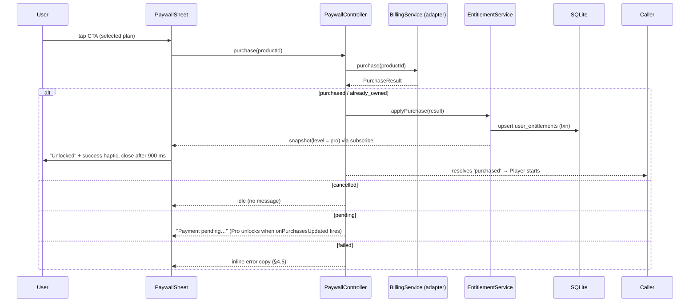

---

## 4. Paywall & Entitlement Architecture

### 4.1 Layering (the decoupling rule)

```
┌─────────────────────────────────────────────────────────────┐
│ UI: PaywallSheet, SessionCard (lock/badge), Journey card     │  knows only: EntitlementService (read) + PaywallProvider (present)
├─────────────────────────────────────────────────────────────┤
│ PaywallProvider (controller)                                 │  orchestrates: selected plan → BillingService.purchase → EntitlementService.applyPurchase
├──────────────────────────────┬──────────────────────────────┤
│ BillingService (adapter)     │ EntitlementService (truth)   │
│  MockBillingAdapter  ← now   │  rules, persistence, gating  │
│  PlayBillingAdapter  ← later │  SQLite: user_entitlements   │
│  RazorpayAdapter     ← later │                              │
└──────────────────────────────┴──────────────────────────────┘
```

**Hard rules.** (1) No UI file imports a billing adapter. (2) `EntitlementService` is the only code that decides whether a protocol/bed/voice/insight is unlocked. (3) The adapter is chosen once, in `createBillingService(env)`, from `EXPO_PUBLIC_BILLING_MODE` (`mock` | `google_play` | `razorpay`). (4) Swapping adapters must not change any UI file, any schema, or any test of `EntitlementService`.

### 4.2 Products & Pricing

| Product ID | Kind | Price (INR) | Google Play type (later) | Entitlement granted |
|---|---|---|---|---|
| `ember_pro_monthly` | subscription, P1M | ₹79 / month | Subscription, base plan `monthly-autorenew` | `pro` until `expires_at` |
| `ember_pro_lifetime` | lifetime | ₹1,199 once | One-time (managed in-app) product | `pro` forever |

Anchoring math used in copy: ₹1,199 ÷ ₹79 = 15.2 months → approved copy line is **"Equal to about 15 months of Monthly."** ₹79 ÷ 30 = ₹2.63/day → copy says "About ₹2.60 a day."

> **Copy-accuracy rule:** any figure shown in the paywall must be derived from `BillingProduct.priceMicros` at runtime (never hard-coded) once real billing is live. In mock mode the same derivation is applied to the seeded mock products so the code path is identical.

**What Pro unlocks (the entitlement matrix):**

| Capability | Free | Free pass (active) | Pro |
|---|---|---|---|
| 5-min Rapid Reset | ✔ | ✔ | ✔ |
| 10-min Afternoon Recharge | ✔ | ✔ | ✔ |
| 30-min Deep Rest & Yoga Nidra | ✘ | ✔ (until consumed/expired) | ✔ |
| Premium narrator voices (Arjun Deep, etc.) & Ambient beds (Ocean Drift, Night Forest, 2 Hz Delta) | ✘ (Free voice only) | ✘ | ✔ |
| Journey: full history + Calm Delta breakdown + weekly chart + best time-of-day | ✘ (last 7 sessions + headline only) | ✘ | ✔ |
| Sleep Mode, Focus Mode, Sigh Pacer, heatmap, streak, Grace | ✔ | ✔ | ✔ |

### 4.3 Interfaces (`src/billing/types.ts`)

```ts
export type ProductId = 'ember_pro_monthly' | 'ember_pro_lifetime';
export type Unsubscribe = () => void;

export interface BillingProduct {
  id: ProductId;
  kind: 'subscription' | 'lifetime';
  title: string;
  priceMicros: number;          // 79_000_000 for ₹79
  currency: 'INR';
  localizedPrice: string;       // '₹79'
  period?: 'P1M';
}

export type PurchaseStatus = 'purchased' | 'cancelled' | 'pending' | 'failed' | 'already_owned';
export interface PurchaseResult {
  status: PurchaseStatus;
  productId?: ProductId;
  orderId?: string;
  purchaseToken?: string;
  purchasedAtMs?: number;
  expiresAtMs?: number | null;  // null for lifetime
  error?: { code: 'network' | 'billing_unavailable' | 'item_unavailable' | 'unknown'; message: string };
}
export type OwnedPurchase = Required<Pick<PurchaseResult, 'productId' | 'purchaseToken'>> &
  Pick<PurchaseResult, 'orderId' | 'purchasedAtMs' | 'expiresAtMs'>;

/** Adapter boundary. Everything provider-specific lives behind this. */
export interface BillingService {
  readonly id: 'mock' | 'google_play' | 'razorpay';
  init(): Promise<void>;
  getProducts(): Promise<BillingProduct[]>;
  purchase(productId: ProductId): Promise<PurchaseResult>;
  restore(): Promise<OwnedPurchase[]>;
  /** For purchases completing outside the flow (pending→purchased, renewals, refunds). */
  onPurchasesUpdated(cb: (owned: OwnedPurchase[]) => void): Unsubscribe;
  dispose(): void;
}
```

```ts
// src/billing/entitlementTypes.ts
export type AccessLevel = 'pro' | 'free_pass' | 'free';
export interface EntitlementSnapshot {
  level: AccessLevel;
  plan: 'none' | 'monthly' | 'lifetime';
  proExpiresAtMs: number | null;       // null for lifetime or none
  passAvailable: boolean;
  passExpiresAtMs: number | null;
  passConsumedAtMs: number | null;
  passGrantedCount: number;
  lastVerifiedAtMs: number | null;
}
export type PaywallVariant = 'default' | 'post_taste' | 'pass_expired' | 'pro_expired' | 'bed_locked' | 'voice_locked' | 'insights';
export type GateDecision =
  | { allowed: true; via: 'free' | 'pro' | 'free_pass' }
  | { allowed: false; reason: 'pro_required'; paywallVariant: PaywallVariant };

export interface EntitlementService {
  init(): Promise<void>;
  getSnapshot(): EntitlementSnapshot;
  subscribe(cb: (s: EntitlementSnapshot) => void): Unsubscribe;
  canStartProtocol(id: ProtocolId): GateDecision;
  canUseBed(bedId: string): GateDecision;
  canUseVoice(voiceId: string): GateDecision;
  canViewProInsights(): GateDecision;
  grantFreePass(): Promise<boolean>;                     // false if rules forbid
  consumeFreePass(sessionId: string): Promise<void>;     // idempotent
  applyPurchase(r: PurchaseResult): Promise<void>;
  applyOwned(owned: OwnedPurchase[]): Promise<void>;     // restore / updates; replaces provider-sourced rows
  expireStale(): Promise<void>;                          // run on foreground
}
```

```ts
// src/billing/PaywallProvider.tsx (contract)
export type PaywallContext = {
  source: 'begin_locked' | 'bed_locked' | 'voice_locked' | 'insights_teaser' | 'membership';
  variant: PaywallVariant;
  protocolId?: ProtocolId;
};
export type PaywallOutcome = 'purchased' | 'restored' | 'dismissed' | 'alternative_chosen';
export interface PaywallProvider {
  present(ctx: PaywallContext): Promise<PaywallOutcome>;   // resolves when the sheet closes
  dismiss(): void;
}
```

### 4.4 Data Flows

**Purchase (identical for every adapter):**



**App start / foreground:** `EntitlementService.init()` loads rows → `resolve()` → emits snapshot immediately from local state (UI never waits on the network) → `BillingService.init()` + `restore()` in the background → `applyOwned()` reconciles. `expireStale()` marks past-due subscription and pass rows.

**Free pass:** `grantFreePass()` called by the commit transaction (§3.5); `consumeFreePass(sessionId)` called by the session controller at 20 % playback of the pass session.

### 4.5 Paywall UI Copy Deck (en-IN)

**Common:** value props (4 bullets) — *30-min Deep Rest & Yoga Nidra* · *Premium narrator voices & soundscapes* · *Full history & Calm Delta insights* · *Sleep Mode, built for the night.*

| Variant | Headline | Sub-headline | Default CTA |
|---|---|---|---|
| `default` | Rest that reaches deeper. | 30 minutes of guided Yoga Nidra for the nights that need more. | Unlock Deep Rest · ₹1,199 once |
| `post_taste` | You've felt Deep Rest. Keep it? | Thirty minutes, whenever you need them. | Keep Deep Rest · ₹1,199 once |
| `pass_expired` | Your free pass has ended. | Keep Deep Rest for good. | Unlock Deep Rest · ₹1,199 once |
| `pro_expired` | Welcome back. | Pick up where you left off. | Restart Pro · ₹79 / month |
| `bed_locked` | A softer night. | Ocean Drift, Night Forest and Delta Waves are part of Pro. | Unlock Pro · ₹1,199 once |
| `voice_locked` | A voice made for the night. | Unlock every narrator voice, Deep Rest Yoga Nidra, and premium soundscapes. | Unlock Pro · ₹1,199 once |
| `insights` | See what actually helps. | Full history and your Calm Delta by session, mode and time of day. | Unlock Pro · ₹1,199 once |

**Plan cards:** Lifetime — ribbon **BEST VALUE**, title *Lifetime*, price `₹1,199`, line 1 *Pay once, rest forever.*, line 2 *Equal to about 15 months of Monthly.* · Monthly — title *Monthly*, price `₹79 / month`, line *About ₹2.60 a day. Cancel anytime.* (in mock mode: "Cancel anytime" is replaced by "Test plan").

**CTA label by selection:** Lifetime → `Unlock Deep Rest · ₹1,199 once`; Monthly → `Start Pro · ₹79 / month`. Loading → spinner. Success → `Unlocked`.

**Secondary actions:** `Restore purchases` · `Not now` · `Try the 10-minute recharge instead` (only when opened from a locked 30-min Begin; closes sheet with outcome `alternative_chosen` and starts the 10-min session with current mode/bed).

**Footer legal (real-billing phases):** *Monthly renews automatically until you cancel in Google Play. Lifetime is a one-time purchase. Ember is a relaxation tool, not a medical device.* · links: *Terms* · *Privacy* (URLs required by Play; **placeholders `https://<your-domain>/terms` and `/privacy` must be replaced before any Play submission**).

**Errors & states:**

| Condition | Copy | Behavior |
|---|---|---|
| `cancelled` | *(none)* | CTA returns to idle |
| `failed` (`unknown`) | That didn't go through. You haven't been charged. | Inline, muted; CTA re-enabled |
| `failed` (`network`) | Can't reach Google Play right now. Try again in a moment. | Inline |
| `billing_unavailable` | Purchases aren't available on this device right now. | Inline |
| `pending` | Your payment is pending. Pro will unlock automatically when it completes. | CTA disabled, "Close" shown |
| `already_owned` | You already have Pro — restored. | Auto-restores and closes |
| Restore found nothing | We couldn't find a previous purchase on this account. | Inline |

### 4.6 Persistence & Resolution Rules

**Storage:** table `user_entitlements` (§5.2). Provider-sourced rows (`source ∈ {mock, google_play, razorpay}`) are replaced wholesale by `applyOwned`; `free_pass` rows are app-generated and never touched by billing sync.

**Resolution (pure function `resolveEntitlement(rows, nowMs)` — fully unit-tested):**

```
1. any row kind='lifetime' status='active'                                  → level 'pro', plan 'lifetime'
2. any row kind='subscription' status='active' and nowMs < expires_at + OFFLINE_GRACE (3 days)
                                                                            → level 'pro', plan 'monthly', proExpiresAt = expires_at
3. any row kind='free_pass' status='available' and nowMs < expires_at       → level 'free_pass'
4. otherwise                                                                → level 'free'
Pro always wins over pass. A pass may coexist with Pro (ignored until Pro lapses).
```

**Gate decision (`canStartProtocol`):** tier `free` → `{allowed, via:'free'}`; tier `pro` → level `pro` → `via:'pro'`; level `free_pass` → `via:'free_pass'`; else deny with variant chosen by: pass `consumed` → `post_taste`; pass `expired` → `pass_expired`; a subscription row exists but is expired → `pro_expired`; otherwise `default`.

**Offline behavior:** nothing in the entitlement path requires the network; a subscription stays honored for 3 days past `expires_at` if the device is offline (`OFFLINE_GRACE_MS = 259_200_000`), after which it resolves to `free` until the next successful `restore()`.

**Flags that must survive process death and reinstall-over-top:** all of the above live in SQLite (not React state). `allowBackup=false` means a reinstall resets mock entitlements by design; real purchases return via `restore()`.

### 4.7 Mock Gateway, Test-Mode Purchase Flow & Developer Panel

The mock adapter makes lock → paywall → unlock → badges → persistence work end-to-end **today** with zero payment code.

```ts
// src/billing/MockBillingAdapter.ts
export type MockOutcome = 'success' | 'cancel' | 'fail' | 'pending';
export interface MockConfig { latencyMs: number; nextOutcome: MockOutcome }

export class MockBillingAdapter implements BillingService {
  readonly id = 'mock' as const;
  private listeners = new Set<(o: OwnedPurchase[]) => void>();
  private owned: OwnedPurchase[] = [];
  constructor(private clock: Clock, private store: MockOwnedStore, public cfg: MockConfig = { latencyMs: 900, nextOutcome: 'success' }) {}

  async init() { this.owned = await this.store.load(); }
  async getProducts(): Promise<BillingProduct[]> {
    return [
      { id: 'ember_pro_monthly',  kind: 'subscription', title: 'Monthly',  priceMicros: 79_000_000,    currency: 'INR', localizedPrice: '₹79',    period: 'P1M' },
      { id: 'ember_pro_lifetime', kind: 'lifetime',     title: 'Lifetime', priceMicros: 1_199_000_000, currency: 'INR', localizedPrice: '₹1,199' },
    ];
  }
  async purchase(id: ProductId): Promise<PurchaseResult> {
    await sleep(this.cfg.latencyMs);
    const outcome = this.cfg.nextOutcome; this.cfg.nextOutcome = 'success';
    if (outcome === 'cancel')  return { status: 'cancelled' };
    if (outcome === 'fail')    return { status: 'failed', error: { code: 'unknown', message: 'Mock failure' } };
    if (outcome === 'pending') return { status: 'pending', productId: id };
    const now = this.clock.now();
    const res: PurchaseResult = {
      status: 'purchased', productId: id, orderId: `MOCK-${now}`, purchaseToken: `mock-token-${now}`,
      purchasedAtMs: now, expiresAtMs: id === 'ember_pro_monthly' ? now + 30 * 86_400_000 : null,
    };
    this.owned = [...this.owned.filter(o => o.productId !== id), res as OwnedPurchase];
    await this.store.save(this.owned);
    return res;
  }
  async restore() { return this.owned; }
  onPurchasesUpdated(cb: (o: OwnedPurchase[]) => void) { this.listeners.add(cb); return () => { this.listeners.delete(cb); }; }
  dispose() { this.listeners.clear(); }
  /* dev-only */ async devGrant(id: ProductId) { /* write owned + notify listeners */ }
  async devRevokeAll() { this.owned = []; await this.store.save([]); this.listeners.forEach(l => l([])); }
}
```

**Test-mode UX:** in `mock` mode the Paywall shows the un-removable `⚠ TEST MODE — no real charge` banner, the CTA runs through `MockBillingAdapter` (900 ms spinner → success haptic → "Unlocked"), then Pro badges replace locks everywhere (Sanctuary card, Journey membership card, premium beds & voices). Killing and relaunching the app keeps the unlocked state (SQLite).

**Developer Panel** (`src/features/dev/DevPanel.tsx`, opened by 7 taps on the Journey version row; compiled in only when `__DEV__ || EXPO_PUBLIC_BILLING_MODE === 'mock'`):

| Control | Effect |
|---|---|
| Grant Monthly / Grant Lifetime / Revoke all | `MockBillingAdapter.devGrant` / `devRevokeAll` |
| Expire monthly now | Sets `expires_at = now − 4 days` (past offline grace) |
| Next purchase outcome: success / cancel / fail / pending | `cfg.nextOutcome` |
| Grant free pass / Reset pass | Writes/clears the `free_pass` row (ignores lifetime cap) |
| Time travel: +1 day / −1 day / reset | `DevClock.offsetDays`; re-runs `expireStale`, `projectStreak`, notification planning |
| Seed 30 days of sample history | Inserts deterministic sessions to exercise heatmap/Calm Delta |
| Reset all data | Drops tables, re-runs migrations + seed (requires confirm, `dangerMuted` button) |

### 4.8 Real Billing Adapters (later phase) & Policy Notes

| Adapter | When | Notes |
|---|---|---|
| `PlayBillingAdapter` | **First real integration.** | Use Google Play Billing via RevenueCat (`react-native-purchases`) **or** `react-native-iap`; both need a dev build/prebuild (already the project's model). Map `ember_pro_monthly` → subscription base plan, `ember_pro_lifetime` → one-time product. **Acknowledge every purchase within 3 days or Google refunds it.** RevenueCat gives server-side receipt validation without writing a backend; pure client-side Play Billing can be tampered with on rooted devices (acceptable risk at this price point; Play Integrity is the next hardening step). |
| `RazorpayAdapter` | Only for a non-Play (sideloaded/web) distribution. | Requires a small server to create orders and verify payment signatures (never ship the key secret in the app). UPI/cards/wallets covered. **Google Play's payments policy generally requires Play Billing for digital goods in Play-distributed apps; verify current India-specific options and policy text before using any alternative.** |

**Migration checklist for turning on a real adapter:** implement `BillingService`; add product IDs in Play Console (subscription base plan + one-time product); set `EXPO_PUBLIC_BILLING_MODE=google_play`; remove the mock banner path from release builds; set `applyOwned` as the single sync entry point; run the §4.6 resolution tests unchanged; add `restore()` on app start and on foreground.

### 4.9 Asset Gating Reality & Hardening

In v1 all audio ships inside the APK; the 30-min asset is *hidden*, not *protected*. That is an intentional trade-off for a ₹79 product and a mock-billing phase. When real billing lands, upgrade in this order: (1) move `deep_rest_30.*` and premium beds/voices into a **Play Asset Delivery** fast-follow pack (not in the base APK; also shrinks the base download by ~15 MB); (2) or download them post-purchase from a signed URL; (3) keep the `EntitlementService` check as the UX gate in all cases.