# MASTER_PLAN.md — Ember: NSDR & Deep Rest (Part 1: Overview, Positioning & UI Wireframes)

> Android-first, offline-first, neuroscience-informed NSDR & meditation app.
> Authoring roles: Executive Planning Director · Principal Product Designer · Lead Mobile Architect.
> Build target: React Native (Expo prebuild / CNG) → Gradle `assembleRelease` → installable `.apk` via GitHub Actions. Implementation agent: OpenAI Codex.
> Plan version: 1.1 · Written: 8 Nov 2026 (Audited & Finalized: Multi-voice, compact layout, non-medical language)

---

## 0. How to Read This Document (and Decisions Made Where the Brief Was Ambiguous)

Every section below is written to be executed, not admired. Constants referenced in more than one section live in **§3.2 (`constants.ts`)**; if a number differs between sections, §3.2 wins.

The brief contained a handful of internal tensions. They are resolved here, once, so the implementing agent never has to guess.

| # | Ambiguity in the brief | Decision |
|---|---|---|
| D1 | "Strictly 2 primary views" but three screens are listed (Sanctuary, Player, Journey). | **Two routes**: `Sanctuary` (`/`) and `Player` (`/player`). **Journey** and **Paywall** are bottom sheets hosted at the root. The Post-Session Check-In is a *stage inside Player*, not a route. |
| D2 | Time-of-day highlight windows leave gaps (03:00–04:00 and 18:00–20:00). | 04:00–12:59 → 5-min · 13:00–19:59 → 10-min · 20:00–03:59 → 30-min (table in §3.7). Treated as helpful defaults, not medical prescriptions; user selection always sticks. |
| D3 | Focus vs Sleep modes need different endings, but one narration file can't both wake and lull. | Each of the 10-min and 30-min protocols ships **two fully-rendered voice files per voice** (`*.focus.ogg`, `*.sleep.ogg`) that share an identical body and differ only in a final 90 s outro. 5-min has one file (Focus-style ending, no toggle). |
| D4 | "30m asset unlocked via entitlement" — but assets bundled in an APK can be extracted. | Gating in v1 is **UX-level, not DRM**. §4.9 documents the upgrade path (Play Asset Delivery / post-purchase download) for when real billing lands. |
| D5 | Razorpay is listed beside Google Play Billing as if interchangeable. | For digital goods consumed in an app distributed through Google Play, **Google Play Billing is the default and Razorpay is generally not permitted as a substitute**. Razorpay is still valid for a sideloaded/web build. The adapter pattern supports both; verify current Play policy before shipping a paid build (§4.8). |
| D6 | "Before and after" check-in is required, yet start must take ≤2 taps / <5 s. | The *pre* check-in is **non-blocking**: it appears over the Player during the first 20 s while audio is already playing. One optional tap. The *post* check-in is a Player stage after the session. |
| D7 | The free-pass hook says "1 complimentary pass" without specifying consumption. | One pass per install lifetime; valid 14 days; **consumed when the 30-min session passes 20 % playback**, not at tap — so a crash or accidental start doesn't burn it (§3.5). |
| D8 | VoiceStudio's exact CLI/API surface. | VoiceStudio (`debpalash/VoiceStudio`) is an actively developed beta that runs locally and, per public project descriptions, exposes a local REST API with an **OpenAI-compatible audio API**, plus Docker images and a CLI. This plan wraps it behind a `TtsAdapter` calling an OpenAI-style `/v1/audio/speech` endpoint. **Endpoint path, model name, voice IDs, and auth must be confirmed against https://voicestudio.sh/docs on the day the pipeline is built**; the adapter isolates that risk to one file (§6.4). |
| D9 | 6 Hz "Theta Waves" are binaural beats. | They require **stereo headphones** to have any acoustic separation. The UI shows a one-time "Best with headphones" hint on first selection, and the ambient bed is mastered so it is still pleasant through a speaker. |

---

## 1. Executive Product Overview & ASO Positioning

### 1.1 Product Thesis

**Zero-overwhelm guided rest and nervous system decompression.** Open the app, tap once or twice, be resting in under 5 seconds. Three protocols. No library, no search, no "explore" tab, no account, no network. Ember is a relaxation tool, not a clinical treatment or medical device.

Three non-negotiable product truths:

1. **Fewer choices beat more content.** Three sessions, each with one job. If a feature adds a choice, it must remove two others.
2. **The app must never punish rest.** No red, no urgency, no "you'll lose your streak." Falling asleep must be treated as success.
3. **Offline, private, local.** No sign-in, no analytics SDK, no cloud. All core sessions and personal history live in SQLite on-device. This is also the cleanest possible Play Data Safety declaration ("no data collected").

### 1.2 App Name Options

Brand line is fixed: **"NSDR & Deep Rest"**. Play Store title limit is 30 characters.

| Option | Play title (chars) | Package ID | Why it works | Risk |
|---|---|---|---|---|
| **Ember** *(recommended)* | `Ember: NSDR & Deep Rest` (23) | `com.emberrest.app` | "Ember" matches the warm-amber palette and the streak mechanic (an ember you keep glowing, never a flame you can extinguish). Short, pronounceable, ownable icon (a ring with a glowing core). | Common word; **check Play Store search and trademark conflicts before committing.** |
| Hearth | `Hearth: NSDR & Deep Rest` (24) | `com.hearthrest.app` | Warmth, shelter, evening. | Crowded name space (many home/kitchen apps). |
| Stillwell | `Stillwell: NSDR & Deep Rest` (27) | `com.stillwell.rest` | Calm connotation, distinctive. | Longer; weaker link to the ember streak metaphor. |
| Ebb | `Ebb: NSDR & Deep Rest` (21) | `com.ebbrest.app` | Very short; "ebb" = the nervous system receding. | Very short names are hard to rank and easy to confuse. |

**Recommendation:** ship as **Ember**. All identifiers in this plan use `ember` / `com.emberrest.app`. Renaming later is a one-file change (`app.config.ts`) plus store assets — but the Android package ID is permanent once published.

### 1.3 Target Persona

**Primary — "The Wired Knowledge Worker" (Riya, 25).** Software/ops/analyst job or final-year student in an Indian metro. Mid-range Android (₹12–25k phone, 4–6 GB RAM, often 32-bit-capable ARM). UPI-native. Has tried Calm/Headspace/Insight Timer and bounced because (a) the library was overwhelming, (b) USD pricing felt wrong, (c) sessions were too long to start in a 10-minute gap.

- **Job to be done:** "Drop my stress to a workable level in the gap between two meetings, and settle my mind faster on the nights my thoughts won't stop."
- **Triggers:** pre-meeting jitters, 2–4 PM afternoon slump, 11 PM–2 AM evening restlessness.
- **Objection to overcome:** "Will this actually do anything?" → answered by the **Calm Delta** (their own self-reported before/after perceived state shift), not by exaggerated claims.
- **Price psychology:** ₹79 is below a chai-and-snack threshold (impulse); ₹1,199 is framed against 15 months of the monthly plan.

**Secondary — "The Night-Wire" (Karan, 31).** Shift-adjacent worker or parent with fragmented sleep. Lives in Sleep Mode. Converts to Lifetime because they want it forever and don't want a recurring charge.

**Device & environment constraints (design for these):**

| Constraint | Budget |
|---|---|
| Cold start to interactive Sanctuary | ≤ 2.0 s on a 4 GB / Snapdragon 6-series class device |
| Release APK size (universal, arm64-v8a + armeabi-v7a) | ≤ 70 MB, hard stop 90 MB |
| Resident memory during playback | ≤ 180 MB |
| Battery during a 30-min screen-off Sleep session | ≤ 3 % |
| Connectivity required | **None** (billing, in later phases, is the only network use) |
| Minimum Android version | API 24 (Android 7.0) |

### 1.4 The Core Loop

```mermaid
flowchart LR
    A[Open app] --> B[Sanctuary: card pre-selected by time of day]
    B -->|1 tap: Begin Rest| C{Card locked?}
    C -- No --> D[Player: audio starts instantly]
    C -- Yes, no pass --> P[Paywall sheet]
    C -- Yes, pass active --> D
    P -- Purchase / Mock purchase --> D
    P -- Try 10-min instead --> D
    D --> E[Optional pre-state tap, first 20 s]
    E --> F[Session runs: voice + ambient bed]
    F --> G{Mode}
    G -- Focus --> H[Rising chime + haptic pulse]
    G -- Sleep --> I[85 percent: silent auto-commit, 90 s fade-out]
    H --> J[Post check-in: 1 tap]
    I --> K[Optional morning-after check-in]
    J --> L[Calm Delta + streak ember update]
    K --> L
    L --> M[Streak credit, Grace Day banked every 5 days]
    M --> N[3-day streak? 1 free Deep Rest pass]
    N --> O[Next tap on 30-min card after pass: paywall]
    L --> Q[One gentle reminder at a learned time]
    Q --> A
```



```
   open ──► tap Begin Rest ──► session ──► 1-tap check-in ──► Calm Delta + ember
     ▲                                                              │
     │                       3-day streak ──► free 30-min taste ◄───┤
     │                                              │               │
     └────── one gentle reminder ◄─── paywall on next 30-min tap ◄──┘
```

**Loop economics.** The loop has exactly one *reward* (the felt state shift, made visible by the Calm Delta), one *investment* (the ember streak, forgiving by design), one *trigger* (a single time-learned notification), and one *monetization moment* (tap on a locked card, after having experienced it).

### 1.5 ASO Positioning (Google Play, en-IN at launch)

- **Category:** Health & Fitness. **Content rating:** Everyone. **Price:** Free with in-app purchases.
- **Short description (≤ 80 chars, 75 used):**
  `2-tap NSDR: 5-min reset, 10-min recharge, 30-min Yoga Nidra. Works offline.`
- **Long description — first three lines (the only ones most users read):**
  1. *Non-Sleep Deep Rest in two taps. No library. No sign-up. No Wi-Fi.*
  2. *A 5-minute reset for stress, a 10-minute recharge for the afternoon slump, a 30-minute Yoga Nidra for deep restorative rest and sleep.*
  3. *Track how each session actually changes how you feel — your own Calm Delta, not a promise.*
- **Keyword set (use naturally in description; never stuff):** NSDR, non-sleep deep rest, yoga nidra, guided meditation, body scan, physiological sigh, breathing exercise, stress relief, afternoon slump, sleep, deep relaxation, calm, focus reset.
- **Screenshot plan (6, OLED-black frames, amber accent, one caption each):**
  1. Sanctuary — "Two taps to rest."
  2. Player breathing ring — "Breath-synced guidance."
  3. Sleep Mode — "Fall asleep without losing your streak."
  4. Check-in orbs — "See your Calm Delta."
  5. Journey heatmap — "A streak that forgives."
  6. Paywall — "Deep Rest, ₹79/month or ₹1,199 once."
- **Store trust items:** Data Safety = no data collected/shared; list in-app purchases; state plainly in the listing and in-app **About** that narration is **synthetic (AI-generated) voice**; include a non-medical disclaimer: *"Ember is a relaxation tool, not a medical device, and is not a treatment for any condition."*
- **Localization:** `en-IN` at launch; `hi-IN` (UI + narration) is the first post-launch localization because it expands the addressable audience more than any feature.
- **Rating-prompt policy:** prompt for an in-app Google Play review once, after the **7th completed session** when the user is viewing the Journey sheet or after closing the session summary (never during active audio playback). The prompt is neutral and complies strictly with Google Play in-app review guidelines without sentiment-gating.

### 1.6 Success Metrics (hypotheses to validate, not promises)

| Metric | Target (first 90 days) | How measured without an analytics SDK |
|---|---|---|
| Time from launch to audio playing | ≤ 5 s p90 (≤ 2 taps) | Local timing log in dev builds; manual QA stopwatch protocol |
| First-session completion | ≥ 60 % of installs | Play Console + locally tracked in QA cohorts |
| D7 retention | ≥ 25 % | Play Console retention report |
| Free → Pro conversion | 2–4 % of MAU | Play Console subscription/in-app product reports |
| Lifetime : Monthly mix | ≥ 35 % lifetime | Play Console |
| Median Calm Delta (post − pre) | ≥ +1.0 state | Local only; surfaced to the user, never exported |

*Privacy rule:* v1 ships **no analytics SDK**. If instrumentation is added later it must be opt-in and listed in Data Safety.

### 1.7 Explicit Non-Goals (v1)

No accounts or cloud sync. No social/sharing/leaderboards. No content library or search. No journaling/text input. No on-device TTS (audio is pre-rendered). No iOS build (code stays portable; iOS is a v2 decision). No ads, ever.

---

## 2. Screen-by-Screen UI/UX Wireframe & Interaction Spec

### 2.1 Design Tokens (single source of truth: `src/design/tokens.ts`)

#### 2.1.1 Color

| Token | Hex / value | Use |
|---|---|---|
| `bg` | `#000000` | Primary canvas (true OLED black) |
| `surface` | `#0B0B0E` | Cards, sheets (Deep Obsidian) |
| `surfaceRaised` | `#111116` | Pressed/selected card fill |
| `border` | `#1C1C22` | Hairline borders (1 dp) |
| `text` | `#F4F4F6` | Primary text (Warm Alabaster) |
| `textMuted` | `#8E8E99` | Secondary text (Muted Stone) |
| `textFaint` | `#5C5C66` | Disabled / tertiary (use ≥ 14 sp only) |
| `accent` | `#F59E0B` | Primary accent (Candlelight Amber) |
| `accentSoft` | `#FBBF24` | Highlights, ember core, heatmap peak (Soft Gold) |
| `accentPressed` | `#D97706` | Pressed state of amber surfaces |
| `accentGlow` | `rgba(245,158,11,0.18)` | Selected-card halo, orb outer glow |
| `onAccent` | `#000000` | Text/icons on amber (≈10:1 contrast) |
| `scrim` | `rgba(0,0,0,0.72)` | Sheet backdrop |
| `dangerMuted` | `#9A3412` | Destructive confirmations only (reset data). Never used for streak/alerts. |
| `dimMultiplier` | `0.38` | Sleep-mode auto-dim opacity for all chrome |

Heatmap ramp (cell fill by committed minutes that day):

| Level | Rule | Fill |
|---|---|---|
| 0 | no practice | `#14141A` |
| 1 | > 0 and < 5 min | `#3B2A0A` |
| 2 | ≥ 5 and < 10 min | `#7A4F0B` |
| 3 | ≥ 10 and < 30 min | `#C27A0A` |
| 4 | ≥ 30 min | `#FBBF24` |
| Grace-covered day | bridged by Rest Grace | `#14141A` fill + 1.5 dp `#7A4F0B` inner ring |

Check-in state colors (warm-only, no blues/purples):

| State | Value (perceived state score) | Color | Orb label |
|---|---|---|---|
| Wired | 1 | `#EA580C` | Wired |
| Drained | 2 | `#78716C` | Drained |
| Neutral | 3 | `#A8A29E` | Neutral |
| Calm | 4 | `#F59E0B` | Calm |
| Restored | 5 | `#FDE68A` | Restored |

*Contrast check (must pass in a unit test using the WCAG formula):* `text` on `bg` ≥ 15:1; `textMuted` on `bg` ≥ 6:1; `textMuted` on `surface` ≥ 5.5:1; `onAccent` on `accent` ≥ 9:1. No pure white (`#FFFFFF`) and no color with blue channel > red channel anywhere in the UI.

#### 2.1.2 Typography (Fraunces for emotional moments, Inter for everything functional)

Fonts bundled via `@expo-google-fonts/fraunces` (Light 300) and `@expo-google-fonts/inter` (Regular 400, Medium 500, SemiBold 600, ExtraLight 200 for the timer). Splash stays up until fonts load.

| Style | Family / weight | Size / line-height | Tracking | Use |
|---|---|---|---|---|
| `display` | Fraunces 300 | 34 / 40 | −0.5 | Greeting, check-in prompt |
| `displaySm` | Fraunces 300 | 26 / 32 | −0.3 | Paywall headline, summary |
| `timer` | Inter 200, tabular-nums | 56 / 60 | −1 | Remaining time |
| `title` | Inter 600 | 22 / 28 | 0 | Sheet titles |
| `cardTitle` | Inter 500 | 20 / 26 | 0 | Session card name |
| `body` | Inter 400 | 16 / 24 | 0 | Body copy |
| `label` | Inter 500 | 14 / 20 | 0.1 | Chips, buttons, slider labels |
| `caption` | Inter 500 | 12 / 16 | 0.4 | Metadata |
| `badge` | Inter 600 | 10 / 12 | 0.8, UPPERCASE | `PRO` badge |

Font scaling: respect system font scale up to 1.3× (`maxFontSizeMultiplier={1.3}`); layouts below must not clip at 1.3×.

#### 2.1.3 Spacing, Shape, Motion

- **Spacing scale (dp):** 4, 8, 12, 16, 20, 24, 32, 40, 56. Screen horizontal padding: 20.
- **Radii:** card 24 · pill 999 · primary button 28 · sheet top corners 32 · orb/ring circular.
- **Elevation:** none. Depth is expressed with hairline borders and glow, never gray Android shadows.
- **Touch targets:** ≥ 48 × 48 dp everywhere.
- **Easing:** `ease = Easing.bezier(0.22, 1, 0.36, 1)` for entrances; `easeInOut = Easing.bezier(0.45, 0, 0.55, 1)` for breathing.
- **Durations:** press 120 ms · selection 220 ms · sheet 360 ms · stage change 480 ms · breathing per cue.
- **Reduce motion** (system setting *or* preference): replace all scale/translate animations with 150 ms opacity cross-fades; the breathing orb switches to a static ring plus text cue ("Inhale" / "Exhale") and a thin linear progress bar.

#### 2.1.4 Haptic Map (`src/design/haptics.ts`)

All haptics respect `UserPreferences.haptics_enabled`. Use `expo-haptics` for impacts/selection and React Native `Vibration.vibrate(pattern)` for custom Android patterns.

| Trigger | Call | Notes |
|---|---|---|
| Session card selected | `selectionAsync()` | |
| Mode pill toggled | `selectionAsync()` | |
| Ambient chip selected | `selectionAsync()` | |
| **Begin Rest** pressed | `impactAsync(Medium)` | On press-in, not release |
| Locked card tapped | `notificationAsync(Warning)` replaced by `impactAsync(Light)` | Gentle; never an error buzz |
| Sigh pacer — inhale 1 start | `impactAsync(Light)` | |
| Sigh pacer — inhale 2 (top-up) start | `impactAsync(Light)` 200 ms after the first inhale ends | The "double-inhale" feel |
| Sigh pacer — long exhale | 6 × `impactAsync(Light)` at t = 0.0, 0.8, 1.7, 2.7, 3.9, 5.2 s into the exhale | Lengthening intervals = slowing down |
| Breath cue (inhale/exhale) in Player | none by default | Off to avoid constant buzzing; opt-in pref `breath_haptics` |
| Focus-mode session end | `impactAsync(Light)` → 150 ms → `impactAsync(Medium)` | "Soft pulse" synced to chime onset |
| Sleep-mode end | **none** | |
| Check-in orb selected | `selectionAsync()` | |
| Grace Day banked toast | `notificationAsync(Success)` | Once |
| Purchase success | `notificationAsync(Success)` | |
| Sheet drag past snap point | `selectionAsync()` | Debounced to 1 per 150 ms |

### 2.2 Navigation & Component Architecture

```
app/_layout.tsx                  RootProviders → <GestureHandlerRootView> → <Stack screenOptions={{headerShown:false, contentStyle:{backgroundColor:'#000'}}}>
  RootProviders: DbProvider → ClockProvider → EntitlementProvider → PaywallProvider → SheetHost
  SheetHost renders: <JourneySheet/> and <PaywallSheet/> above all routes (controlled by useSheetStore)
app/index.tsx                    Sanctuary (route "/")
app/player.tsx                   Player (route "/player", presentation: 'fullScreenModal', gestureEnabled: false, animation: 'fade')
```

Deep link scheme `ember://begin?protocol=<id>` (notifications) opens Sanctuary with that card pre-selected. Back button behavior: on Sanctuary, a sheet open → closes sheet; otherwise exits app. On Player → opens the "End session?" confirm (never exits silently).

### 2.3 Screen 1 — Sanctuary (Home)

**Purpose:** get to audio in ≤ 2 taps. **Responsive layout spec:** The screen uses a vertical `ScrollView` with bottom content insets (`paddingBottom: 96`). On taller displays (e.g. 360 × 800 dp), all elements fit comfortably within the viewport. On compact viewports (e.g. 360 × 640 dp) or under system font scaling (up to 1.3×), the content scrolls cleanly without clipping. The primary **Begin Rest** CTA is mounted in a sticky bottom container above the Android navigation bar inset, ensuring immediate 1-tap access at all times.

```
┌──────────────────────────────────────┐ 360 x 800 dp reference (scrollable on compact screens)
│ status bar (transparent, edge-to-edge)│
│                                       │
│ ( ◉ 4 )                               │  56dp top bar: StreakPill (left, tap → opens Journey sheet)
│                                       │
│ Good afternoon.                       │  display 34/40, alabaster
│ The afternoon dip is here.            │  body 16/24, muted
│                                       │
│ ┌──────────────────────────────────┐  │
│ │ 5 min   Rapid Reset              │  │  SessionCard x3, 88dp tall, 12dp gap
│ │ Acute stress · pre-meeting       │  │
│ └──────────────────────────────────┘  │
│ ┌══════════════════════════════════┐  │  selected = amber 1.5dp border + accentGlow halo
│ │ 10 min  Afternoon Recharge       │  │
│ │ Post-lunch focus restore         │  │
│ └──────────────────────────────────┘  │
│ ┌──────────────────────────────────┐  │
│ │ 30 min  Deep Rest & Yoga Nidra   │  │  PRO badge + lock icon (or "Free pass" tag)
│ │ Restorative rest · sleep   🔒 PRO│  │
│ └──────────────────────────────────┘  │
│                                       │
│ ( ☼ Focus | ☾ Sleep )                 │  ModeToggle: visible only for 10 & 30 (animated in, 220ms)
│                                       │
│ Ambient  [Off][Rain][Brown][6Hz θ][+] │  AmbientChips (horizontally fits 320dp; "+" opens bed picker)
│ Voice: Maya  ·  Sigh pacer      [ o─]  │  VoiceChip & Switch row, 48dp
│                                       │
│ ┌──────────────────────────────────┐  │
│ │           Begin Rest             │  │  72dp tall sticky CTA, radius 28, amber fill — thumb zone
│ └──────────────────────────────────┘  │
│ nav bar inset                         │
└──────────────────────────────────────┘
```

**Component hierarchy**

```
SanctuaryScreen
├─ StickyBottomContainer
│  └─ BeginRestButton       (pinned above navigation bar inset)
└─ ScrollContent (ScrollView, contentContainerStyle: paddingBottom 96)
   ├─ TopBar
   │  └─ StreakPill         (ember ring + number; single clean entry point to Journey sheet)
   ├─ GreetingBlock         (Greeting + ContextLine)
   ├─ SessionCardList
   │  └─ SessionCard ×3     (props: protocol, selected, access: 'free'|'pro'|'pass'|'locked')
   ├─ ModeToggle            (pill; hidden when protocol.supportsModes === false)
   ├─ AmbientChips          (Off | Rain | Brown Noise | 6Hz θ | +)
   └─ VoiceAndPacerRow      (VoiceChip selector + Sigh Pacer switch)
```

**Behavior spec**

1. **Initial selection** = `timeOfDay.defaultProtocol(now)` (§3.7). Suggested default based on time of day. Recomputed on cold start and on foreground after > 30 min in background. Any manual selection sticks for the active foreground session.
2. **Greeting** (local time): 04:00–11:59 "Good morning." · 12:00–16:59 "Good afternoon." · 17:00–20:59 "Good evening." · 21:00–03:59 "Winding down?". **Context line** per selected card: Rapid Reset → "Two sighs and a release. Five minutes." · Recharge → "The afternoon dip is here. Ten minutes." · Deep Rest → "The night is long enough for this."
3. **Card press:** scale 0.98 (120 ms) → `selectionAsync()` → selected style animates over 220 ms (border color, halo opacity 0→1). Only one selected.
4. **Locked card tap while selected or not:** selecting a locked card selects it normally (so the halo is visible) and swaps the Begin button's leading glyph to a lock icon. Tapping **Begin Rest** on a locked card (no pass) opens the **Paywall sheet**; it never opens automatically on its own.
5. **Free pass active:** the Pro card shows an amber tag **"Free pass"** (replacing the lock) with caption "Yours tonight — expires in N days". Begin Rest starts the session directly.
6. **ModeToggle:** two-segment pill (`☼ Focus` · `☾ Sleep`); default = last used mode, but if the selected card is 30-min and local time is 20:00–03:59 and the user has never chosen a mode, default **Sleep**. Persisted in `UserPreferences.last_mode`. (Note: Sleep Mode is available on both the free 10-min Afternoon Recharge and Pro 30-min Deep Rest).
7. **Ambient chips:** single-select, persisted in `UserPreferences.ambient_bed_id`. Selecting **6Hz θ** the first time shows a 3-second inline hint "Best with headphones" under the chips (then never again). **`+`** opens a small sheet of premium beds (Ocean Drift, Night Forest, 2 Hz Delta Waves) — locked ones show `PRO`; tapping a locked bed opens the Paywall.
8. **VoiceChip:** opens Voice Picker sheet to switch active narrator voice or add/import `.embervoice` packs.
9. **Sigh pacer row:** Switch bound to `UserPreferences.sigh_pacer_default`. For the 5-min card the row is shown but captioned "Already includes two sighs" and defaults off.
10. **Begin Rest:** `impactAsync(Medium)` on press-in; button scales 0.97; on release creates the session row and navigates to `/player` with params `{protocolId, mode, bedId, voiceId, sigh}`. Audio must be audible within **1.5 s** of tap on target hardware (engine pre-warm: the selected protocol's voice asset is `load()`ed when the card is selected).
11. **Soft first-run cue:** only on the very first launch, a one-line whisper under the button — "Tap Begin Rest." — fades after 6 s. No tour, no onboarding carousel.
12. **Empty/edge states:** streak 0 → pill shows an empty ring and "0"; no shaming text anywhere.

**StreakPill visual:** 32 dp tall pill, border `border`, left = 20 dp ember ring (SVG) with a 5-segment arc showing progress toward the next Grace Day (`graceProgress/5`), right = streak number (`label`). Ember core opacity "breathes" 0.7 ↔ 1.0 over 4 s (`easeInOut`, loop; disabled under reduce-motion). States from `projectStreak` (§3.3): `done_today` (core `accentSoft`, full glow), `open` (core `accent`, soft glow), `held_by_grace` (core `accent` at 60 %, tiny second ring), `lapsed/fresh` (empty ring, number 0).

### 2.4 Screen 2 — Pre-Session Sigh Pacer (Player stage `PREROLL`)

Shown only if the pacer switch is toggled ON. Runs **60.0 s = 6 cycles × 10.0 s**. Audio: only the ambient bed fades in (over 3 s); voice is silent.

> [!IMPORTANT]
> The Sigh Pacer is an **optional pre-session ritual** (disabled by default, skippable at any second via the Skip button). Its 60-second duration is strictly **PREROLL** and is excluded from the core session duration (5 min, 10 min, 30 min), streak calculations, and restorative minutes logs. Quick-start is preserved: users who leave the pacer off begin guided audio immediately upon tapping Begin Rest.

```
┌──────────────────────────────────────┐
│  ×                      ☼ Focus      │   close · mode chip
│                                       │
│                                       │
│            ╭────────────╮             │
│          ╱    ╭────╮      ╲           │   breathing orb inside a 280dp ring
│         │    │  ●   │      │          │
│          ╲    ╰────╯      ╱           │
│            ╰────────────╯             │
│                                       │
│        Inhale through the nose        │   cue label (body, 16/24)
│              3 of 6                   │   caption, muted
│                                       │
│  Double inhale · long exhale          │   explainer, caption, muted
│                                       │
│               Skip                    │   text button, 48dp
└──────────────────────────────────────┘
```

**Cycle timeline (per 10 s cycle):**

| t (s) | Phase | Orb scale (0.55 = rest, 1.0 = full) | Cue label | Haptic |
|---|---|---|---|---|
| 0.0–2.0 | Inhale 1 (nose) | 0.55 → 0.85, `easeInOut` | "Inhale through the nose" | Light @ 0.0 |
| 2.0–2.2 | Micro-pause | hold 0.85 | — | — |
| 2.2–3.4 | Inhale 2 (top-up sniff) | 0.85 → 1.00, `ease` | "A little more" | Light @ 2.2 |
| 3.4–9.4 | Long exhale (mouth) | 1.00 → 0.55, `easeInOut` | "Slowly out through the mouth" | 6 pulses, §2.1.4 |
| 9.4–10.0 | Rest | hold 0.55 | — | — |

Behavior: cycle counter "n of 6"; skip at any time (fade to `ACTIVE`, 480 ms); at 60 s a soft 400 ms orb "settle" then the first voice line begins. Backgrounding the app during the pacer pauses it (the pacer is a foreground-only ritual). If reduce-motion: static ring, label changes only, linear progress bar for the 60 s.

### 2.5 Screen 3 — Active Audio Player (Player stage `ACTIVE`)

```
┌──────────────────────────────────────┐
│  ×                     ☾ Sleep       │   Close (opens End-session confirm) · ModeChip (display only)
│                                       │
│            ╭════════════╮             │   outer: session progress arc (2dp, amber) on hairline track
│          ╱   ╭────────╮   ╲           │   middle: breathing orb (radial gradient amber → transparent)
│         │   │    ●     │   │          │   inner: core dot (6dp, accentSoft)
│          ╲   ╰────────╯   ╱           │
│            ╰════════════╯             │
│                                       │
│          Soften your jaw              │   CueLabel, cross-fades 400ms
│            18:42 left                 │   timer 56sp (tap ring to toggle; hidden by default in Sleep)
│                                       │
│  How are you arriving?  (first 20 s)  │   PreStateStrip: 5 small orbs; fades out after 20s or on tap
│  ◍  ◍  ◍  ◍  ◍                        │
│                                       │
│            ( ❚❚ )                     │   Play/Pause, 72dp outline circle, amber
│                                       │
│  Voice    ○────────●──────   [ Maya ] │   Slider 1 (48dp touch), mic icon, VoiceChip
│  Ambient  ○──────●────────   [ Rain ] │   Slider 2, wave icon; right end shows bed name chip "Rain"
└──────────────────────────────────────┘
```

**Component hierarchy**

```
PlayerScreen
├─ StageSwitch (PREROLL | ACTIVE | ENDING | CHECKIN)
├─ TopBar (CloseButton, ModeChip)
├─ OrbitalRing (Svg: ProgressArc + BreathingOrb + CoreDot)
├─ CueLabel
├─ RemainingTime
├─ PreStateStrip (ACTIVE, first 20 s only)
├─ TransportControls (PlayPause)
├─ MixerSliders (VoiceSlider + VoiceChip, AmbientSlider + BedChip)
```

**Behavior spec**

1. **Breathing orb sync.** The orb is driven by `protocol.cues` (§5.4) and the voice player's `positionMs` (status updates ≈ 250 ms). For the active cue, orb scale animates using the cue's `breath` pattern computed *from `positionMs − cue.startMs`*, so pausing the voice freezes the orb and seeking/resuming re-syncs it. Cues of type `body`/`silence` hold the orb at 0.7 with a slow 6 s ±0.04 scale shimmer.
2. **Sliders & Chips.** Independent **Voice** and **Ambient** gains. Slider value `v ∈ [0,1]` → player volume `v²` (perceptual taper). Defaults 0.90 / 0.50 (persisted). Releasing a slider commits to `UserPreferences`; dragging updates in real time with `selectionAsync()` only at 0.25 increments. Ambient may be set to 0 without stopping the bed. Tapping `[ Maya ]` opens the Voice Picker sheet; tapping `[ Rain ]` cycles beds.
3. **Mode chip** is display-only (mode is locked at start). **Focus** keeps the screen awake (`expo-keep-awake`); **Sleep** does *not* (screen may time out; audio continues via the foreground service).
4. **Sleep auto-dim:** 20 s after the last touch, all chrome animates to `dimMultiplier` opacity over 2 s; touch restores in 200 ms. Timer hidden by default in Sleep.
5. **PreStateStrip:** five 28 dp orbs in state colors (labels appear on long-press and via TalkBack). Tap = `selectionAsync()` + selected orb pulses once + strip fades out after 600 ms; value saved to `session_logs.pre_state`. Ignoring it is fine (`pre_state = NULL`).
6. **Close (×):** opens a bottom confirm "End this session?" with **Keep resting** (default, amber) and **End session**. Android back = same confirm. Ending before the commit threshold stores status `partial` (≥ 2 min listened) or `abandoned`.
7. **Interruptions:** phone call / other app takes audio focus → pause both tracks; resume automatically only if the interruption was transient and ended within 60 s. Headphones unplugged / BT disconnect → pause (never blast the speaker).
8. **Lock screen:** media notification titled with protocol name, subtitle "Sleep mode" / "Focus mode", amber ring artwork, controls: play/pause only (no seek bar, no next/prev).
9. **Bed switch mid-session:** 2 s equal-power cross-fade; selection persisted.
10. **In-Flight Narrator Switching (Mandatory):** Tapping the VoiceChip (`[ Maya ]` / `[ Arjun ]`) allows changing narrators during active playback without session restart. The engine pre-loads the incoming voice track, pre-seeks to the current session millisecond timestamp, waits for the nearest phrase/cue boundary (or executes a 1,500 ms equal-power crossfade) to prevent overlapping speech, seamlessly transitions playback, and persists the choice. If the incoming track fails to load, the engine continues playing the existing narrator without interruption and displays a non-intrusive toast.

### 2.6 Screen 4 — Session End & Post-Session Check-In (Player stages `ENDING` → `CHECKIN`)

**Focus-mode ending (10 min / 30 min / 5 min):**

| t | Event |
|---|---|
| T−0 | Voice outro finishes ("…and whenever you're ready, open your eyes.") |
| T+0.0 s | **Rising harmonic chime** (`chime_rise.wav`, 3.2 s, three stacked partials ascending a perfect fifth; −20 LUFS) + haptic pulse (§2.1.4) |
| T+0.0–2.0 s | Orb expands to 1.0 and fades; ring progress completes with a glow sweep |
| T+2.5 s | Stage cross-fades (480 ms) to `CHECKIN` |
| — | Ambient bed fades out over 6 s |

**Sleep-mode ending:** no chime, no haptic. Ambient fades over the final 90 s (§6.6). At the **85 % mark** the session is silently committed (streak credited, `status='completed'`, `commit_reason='sleep_auto_commit'`). The Player does **not** navigate to CHECKIN (the user may be asleep); at stream end, audio stops, and the screen remains in dim state. The next time Sanctuary opens within 10 hours, a single soft card appears above the greeting: **"How do you feel this morning?"** with the 5 orbs (one tap saves `post_state`, card disappears; swipe to dismiss). This check-in card persists across app restarts within the 10-hour window, but is strictly non-blocking: tapping Begin Rest on Sanctuary bypasses the card and starts a new session (leaving post_state = NULL for the prior session).

```
┌──────────────────────────────────────┐
│                                       │
│                                       │
│        How do you feel now?           │   display 34/40
│                                       │
│    ●      ●      ●      ●      ●      │   5 orbs, 56dp, spaced evenly; color per state
│  Wired  Drained Neutral Calm  Restored│   label 14sp, muted (selected → alabaster)
│                                       │
│                                       │
│               Skip                    │
└──────────────────────────────────────┘
```

**Interaction:** tap an orb → `selectionAsync()`; selected orb scales 1.0 → 1.15 (220 ms), halo appears in its color at 0.25 alpha, others drop to 0.4 opacity. After 700 ms auto-advance to the **Summary** panel (same screen, cross-fade 480 ms):

```
        Wired  →  Calm              (arrow in amber; both words in their state colors)
        +3 Calm Delta
        ◉ Day 4                     (ember ring animates +1, glow sweep)
        A Rest Grace day was banked.   (only when earned; notification haptic)
        You unlocked a free Deep Rest. (only when the 3-day pass is granted; links to Sanctuary card)
                    Done            (amber outline button → router.replace('/'))
```

Rules: if `pre_state` is NULL the summary shows only the post state and streak line. The Calm Delta label is "+N", "0", or "−N"; negative values are shown neutrally ("−1 Calm Delta"), never in red, with the line "Some sessions just need time." Skip leaves `post_state` NULL but still commits the session. The 3-day pass banner appears in this summary **once** (and again as the "Free pass" tag on the Sanctuary card).

### 2.7 Screen 5 — Journey (Bottom Sheet: Log & Streak)

Opened from the Streak pill or Journey button. Height: 92 % snap, draggable, backdrop `scrim`, close on drag-down/back. Content scrolls inside the sheet.

```
┌──────────────────────────────────────┐
│               ───                     │  grabber
│ Journey                               │  title 22/28
│                                       │
│ ◉ 4-day streak     Best 9    ◌ 1 Grace│  StreakHeader (ember ring, longest, banked graces as 2 dots)
│                                       │
│ Last 30 days                          │  label
│ ▢▢▢▣▢▣▢  ← 7 rows (Mon–Sun) × 5 cols  │  Heatmap: 14dp cells, 4dp gaps, oldest column left
│ ▣▣▣▢▣▣▣                               │
│ ...                                   │
│ Less ▢▣▣▣▣ More                       │  legend
│                                       │
│ 312 restorative minutes   |  27 sessions│  StatsRow
│                                       │
│ Your Calm Delta                       │
│ "When you start Wired, your 10-min    │  CalmDeltaCard (headline insight; template §3.8)
│  sessions end Calm or Restored 88% of │
│  the time." (8 sessions)              │
│                                       │
│ Session log                           │
│ Today 2:14 PM  10 min ☼  Wired→Calm   │  SessionRow ×N (last 7 free; unlimited PRO)
│ Yesterday 11:02 PM 30 min ☾ —→Restored│
│ ...                                   │
│ Unlock full history & insights  PRO   │  ProInsightsTeaser (free only) → Paywall
│                                       │
│ Membership & Voices                   │
│ Ember Free  /  Pro · Monthly (renews…)│  MembershipCard; "Manage" or "Upgrade"; Voice Picker link
│ About · Disclaimer · Version          │
└──────────────────────────────────────┘
```

**Spec**

- **Heatmap grid:** columns = ISO weeks (Mon-start), rows = Mon…Sun. Window = the last 30 local days ending today; cells before the window are blank (not level 0). Right-most column contains today (highlighted with a 1 dp `accentSoft` outline). Cells are non-interactive but expose TalkBack labels ("Tuesday 12 November: 10 minutes").
- **Counters:** *Total restorative minutes* = Σ `listened_ms / 60000` for sessions with status `completed` or `partial` (≥ 2 min); round down. *Sessions* = count of `completed`.
- **Session row:** relative day label (Today/Yesterday/weekday + date), time, duration, mode glyph, `pre → post` with state-colored dots, a `PRO` micro-badge if `access_via='pro'`. Tap = expand inline to show ambient bed, voice narrator, and listened minutes.
- **Free vs Pro:** Free shows heatmap, streak, minutes, the headline Calm Delta, and the last 7 sessions. **Pro** adds full history, Calm Delta breakdown by duration, voice, and mode, a weekly Calm Delta bar chart (last 8 weeks), and "best time of day" insight (§3.8).
- **Membership card states:** Free ("Unlock Deep Rest" → Paywall) · Monthly ("Pro · Monthly · renews {date}" / "Pro · Monthly · ends {date}" if cancelled; **Manage** deep-links to Play subscriptions in the real-billing phase) · Lifetime ("Pro · Lifetime · Thank you") · Free-pass ("Free pass · expires in N days").
- **Hidden developer panel:** 7 taps on the version row opens `DevPanel` (only if `__DEV__ || BILLING_MODE==='mock'`); see §4.7.

### 2.8 Screen 6 — Paywall Bottom Sheet

Opened **only** by user action: Begin Rest on a locked card, tapping a locked ambient bed or narrator voice, the Pro insights teaser, or Membership → Upgrade. Never auto-opens, never interrupts a session. Height 84 %.

```
┌──────────────────────────────────────┐
│               ───                     │
│  ☾  (amber moon-ember glyph, 56dp)    │
│  Rest that reaches deeper.            │  displaySm 26/32
│  30 minutes of guided Yoga Nidra for  │  body, muted
│  the nights that need more.           │
│                                       │
│  ✓ 30-min Deep Rest & Yoga Nidra      │  ValueProps (4 rows, 48dp, amber check)
│  ✓ Premium narrator voices & beds     │
│  ✓ Full history & Calm Delta insights │
│  ✓ Full 30-min restorative night rest │  (Note: Sleep Mode is also supported on free 10m sessions)
│                                       │
│ ┌══════════════════════════════════┐  │
│ │ BEST VALUE                        │  │  PlanCard (selected by default = Lifetime)
│ │ Lifetime              ₹1,199      │  │
│ │ Pay once, rest forever.           │  │
│ │ Equal to about 15 months of Mthly.│  │
│ └──────────────────────────────────┘  │
│ ┌──────────────────────────────────┐  │
│ │ Monthly                 ₹79 / mo  │  │
│ │ About ₹2.60 a day. Cancel anytime.│  │
│ └──────────────────────────────────┘  │
│                                       │
│ [ Unlock Deep Rest · ₹1,199 once ]    │  CTA 64dp, amber; label tracks selection
│  Restore purchases   ·   Not now      │  text buttons
│  Try the 10-minute recharge instead   │  alternative (starts Afternoon Recharge)
│  Payment handled by Google Play.      │  caption (shown when real billing active)
│  ⚠ TEST MODE — no real charge         │  (dev/mock only) amber outline banner
└──────────────────────────────────────┘
```

**Spec**

- Plan cards are a radio group (`accessibilityRole="radiogroup"`). Lifetime preselected (anchor), with a "BEST VALUE" ribbon (`badge` style, amber fill). Selected card: 1.5 dp amber border + `accentGlow` halo. Switching plan: `selectionAsync()`, CTA text cross-fades (160 ms).
- **CTA states:** idle · loading (spinner replaces label, button disabled, sheet not dismissible) · success (label → "Unlocked", `notificationAsync(Success)`, 900 ms later sheet closes and the original intent continues — i.e., the Player starts) · error (inline muted message under CTA: "That didn't go through. You haven't been charged." — `cancelled` shows nothing).
- **Variants** (copy swap only; see §4.5): `default`, `post_taste`, `pass_expired`, `bed_locked`, `voice_locked`, `insights`.
- **Dev/Test Mode banner** is rendered only when `BILLING_MODE === 'mock'` and is un-removable in that mode so a mock build can never be mistaken for a paid build.
- The sheet works fully **offline** in mock mode (and, in the real-billing phase, shows the cached product price with an "Unable to reach Google Play" state when offline).

### 2.9 Accessibility & Quality Bar (applies to all screens)

- TalkBack: every control has `accessibilityLabel` + `accessibilityRole`; orbs are announced as "Wired, 1 of 5, button"; the heatmap is a list of labeled cells; the Player announces cue changes at most every 8 s using `accessibilityLiveRegion="polite"`.
- No information conveyed by color alone (state names are always present as text or label).
- All animations 60 fps on target hardware: animate only `transform`/`opacity` via Reanimated worklets; never animate layout.
- Dark-only UI (`userInterfaceStyle: "dark"`); there is no light theme in v1.
- Every interactive element ≥ 48 dp; all text ≥ 12 sp; body copy ≥ 16 sp.