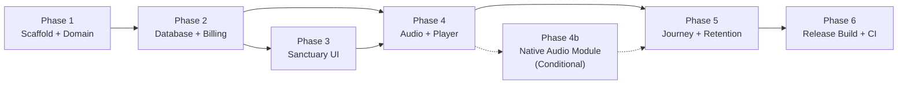

---

## 7. Tech Stack, GitHub Actions APK Build Pipeline & Implementation Phases

### 7.1 Stack Decision & Rationale

| Layer | Choice | Why |
|---|---|---|
| **Framework** | **React Native (Expo, CNG/Prebuild)** | Expo's Continuous Native Generation eliminates committing `android/` to source control while still supporting native modules (`expo-audio`, `expo-sqlite`, `expo-notifications`). One `npx expo prebuild --platform android` regenerates the native project from `app.config.ts`. The entire codebase is TypeScript — Codex builds it without switching languages. |
| **Router** | **Expo Router v4** (file-based, `app/` directory) | Two routes (`/` = Sanctuary, `/player` = Player) + bottom sheets. Deep links (`ember://begin?protocol=<id>`) map directly to Expo Router's scheme handling. |
| **Audio** | **`expo-audio`** (Plan A); native Kotlin module via Expo Modules API (Plan B, §6.9) | `expo-audio` provides background playback, lock-screen controls, and `setAudioModeAsync`. Plan B is a pre-designed escape hatch if dual-player focus issues surface on real devices. |
| **Database** | **`expo-sqlite`** (synchronous API via `openDatabaseSync`) | WAL mode, zero network, instant reads. All state lives in one `ember.db` file. Migration system uses `PRAGMA user_version`. |
| **Animations** | **`react-native-reanimated` v4** + **`react-native-worklets`** | Worklet-based animations for the breathing orb, card selection halos, and sheet transitions. All animated properties are `transform`/`opacity` only (§2.1.3). Reanimated v4 requires New Architecture (Fabric), which is the default in SDK 58. |
| **SVG** | **`react-native-svg`** | Streak ember ring, progress arc, heatmap cells, breathing orb radial gradient. |
| **Haptics** | **`expo-haptics`** + `Vibration` API | See the full haptic map in §2.1.4. |
| **Notifications** | **`expo-notifications`** | One pending date-trigger at a time; Android channel `gentle` (§3.6). |
| **Fonts** | **`@expo-google-fonts/fraunces`**, **`@expo-google-fonts/inter`** | Bundled via Expo's font loading. Splash stays up until fonts resolve (`expo-splash-screen`). |
| **Crypto** | **`expo-crypto`** | `randomUUID()` for all primary keys. |
| **Screen wake** | **`expo-keep-awake`** | Focus mode only (§6.8). |
| **Build** | **EAS Build (local) or Gradle `assembleRelease`** | GitHub Actions runs `npx expo prebuild --platform android` then `cd android && ./gradlew assembleRelease`. No EAS cloud required — the APK is built locally in CI. |
| **Language** | **TypeScript 5.x, strict mode** | `"strict": true`, `"noUncheckedIndexedAccess": true`, `"exactOptionalPropertyTypes": true`. No `any` outside generated files. |
| **Linting / formatting** | **ESLint (Expo preset)** + **Prettier** | Single config; CI fails on lint errors. |
| **Testing** | **Jest** (unit) + **`better-sqlite3`** (SQL in CI) | Domain logic and SQL queries are tested in Node (no emulator). Integration tests run on a physical device or emulator manually before release. |
| **State management** | **Zustand** (tiny, no boilerplate) | `useSheetStore` (which sheets are open), `useSessionStore` (active session state). All persistent state lives in SQLite via repositories; Zustand is ephemeral UI state only. |

### 7.2 Project Structure (canonical)

```
ember/
├── .github/
│   └── workflows/
│       └── build-apk.yml              # §7.5
├── app/
│   ├── _layout.tsx                     # RootProviders → GestureHandlerRootView → Stack
│   ├── index.tsx                       # Sanctuary (route "/")
│   └── player.tsx                      # Player (route "/player")
├── assets/
│   ├── audio/
│   │   ├── voice/                      # *.ogg (Opus 32 kbps mono per voice)
│   │   ├── beds/                       # *.ogg, *.flac
│   │   ├── chime_rise.wav
│   │   └── LICENSES.md
│   ├── fonts/                          # auto-linked by @expo-google-fonts
│   ├── icon.png                        # 1024×1024 adaptive icon source
│   ├── splash.png                      # OLED black + amber ember ring
│   └── adaptive-icon.png
├── plugins/
│   └── withReleaseSigning.ts           # Expo config plugin for Gradle signing
├── src/
│   ├── design/
│   │   ├── tokens.ts                   # §2.1.1 color, type, spacing, shape
│   │   └── haptics.ts                  # §2.1.4
│   ├── domain/
│   │   ├── constants.ts                # §3.2 — single source of truth
│   │   ├── clock.ts                    # Clock interface, SystemClock, DevClock
│   │   ├── dayKey.ts                   # DayKey type, dayKeyFromMs, daysBetween, addDays
│   │   ├── streakEngine.ts             # §3.3 applyCredit, projectStreak, qualifiesForFreePass
│   │   ├── sessionMachine.ts           # §3.4 pure reducer + effect types
│   │   ├── calmDelta.ts                # §3.8 insight computation
│   │   ├── timeOfDay.ts                # §3.7 defaultProtocol, greeting
│   │   └── notificationPlanner.ts      # §3.6 planNextNotification
│   ├── data/
│   │   ├── db.ts                       # Db interface, ExpoSqliteDb, TestDb (better-sqlite3)
│   │   ├── migrations.ts               # §5.2 ordered SQL migrations
│   │   ├── types.ts                    # §5.3 TypeScript models
│   │   ├── queries.ts                  # §5.5 raw SQL strings
│   │   └── repos/
│   │       ├── SessionRepo.ts
│   │       ├── StreakRepo.ts
│   │       ├── LedgerRepo.ts
│   │       ├── EntitlementRepo.ts
│   │       ├── PrefsRepo.ts
│   │       ├── ProtocolRepo.ts
│   │       └── VoiceRepo.ts
│   ├── billing/
│   │   ├── types.ts                    # §4.3 BillingService, EntitlementService interfaces
│   │   ├── entitlementTypes.ts         # §4.3 AccessLevel, GateDecision, etc.
│   │   ├── MockBillingAdapter.ts       # §4.7
│   │   ├── EntitlementServiceImpl.ts   # §4.6 resolution logic
│   │   ├── PaywallProvider.tsx         # §4.3 PaywallProvider context + controller
│   │   └── createBillingService.ts     # factory: env → adapter
│   ├── audio/
│   │   ├── AudioDriver.ts             # §6.7 PlayerHandle, AudioDriver interface
│   │   ├── ExpoAudioDriver.ts         # Plan A implementation
│   │   ├── DualTrackEngine.ts          # §6.7 voice + ambient orchestration
│   │   ├── VoicePackService.ts         # Runtime .embervoice pack importer
│   │   ├── assetRegistry.generated.ts  # generated — static require() map
│   │   ├── protocols.generated.json    # generated — cues, SHA-256, asset versions
│   │   └── beds.ts                     # static ambient bed declarations
│   ├── features/
│   │   ├── sanctuary/
│   │   │   ├── SanctuaryScreen.tsx
│   │   │   ├── TopBar.tsx
│   │   │   ├── StreakPill.tsx
│   │   │   ├── GreetingBlock.tsx
│   │   │   ├── SessionCardList.tsx
│   │   │   ├── SessionCard.tsx
│   │   │   ├── ModeToggle.tsx
│   │   │   ├── AmbientChips.tsx
│   │   │   ├── VoiceAndPacerRow.tsx     # VoiceChip selector + Sigh Pacer switch
│   │   │   └── BeginRestButton.tsx
│   │   ├── player/
│   │   │   ├── PlayerScreen.tsx
│   │   │   ├── OrbitalRing.tsx         # SVG: ProgressArc + BreathingOrb + CoreDot
│   │   │   ├── CueLabel.tsx
│   │   │   ├── RemainingTime.tsx
│   │   │   ├── PreStateStrip.tsx
│   │   │   ├── TransportControls.tsx
│   │   │   ├── MixerSliders.tsx        # VoiceSlider + VoiceChip, AmbientSlider + BedChip
│   │   │   ├── VoicePickerSheet.tsx    # Switch narrator voice / import pack
│   │   │   ├── PostCheckIn.tsx
│   │   │   ├── SessionSummary.tsx
│   │   │   ├── SighPacer.tsx
│   │   │   └── SessionController.ts    # thin side-effect executor for sessionMachine
│   │   ├── journey/
│   │   │   ├── JourneySheet.tsx
│   │   │   ├── StreakHeader.tsx
│   │   │   ├── Heatmap.tsx
│   │   │   ├── StatsRow.tsx
│   │   │   ├── CalmDeltaCard.tsx
│   │   │   ├── SessionRow.tsx
│   │   │   ├── ProInsightsTeaser.tsx
│   │   │   └── MembershipCard.tsx
│   │   ├── paywall/
│   │   │   ├── PaywallSheet.tsx
│   │   │   ├── PlanCard.tsx
│   │   │   └── ValueProps.tsx
│   │   └── dev/
│   │       └── DevPanel.tsx            # §4.7 — compiled only in dev/mock
│   ├── providers/
│   │   ├── DbProvider.tsx
│   │   ├── ClockProvider.tsx
│   │   ├── EntitlementProvider.tsx
│   │   └── SheetHost.tsx               # renders Journey + Paywall + VoicePicker sheets above all routes
│   └── stores/
│       ├── useSheetStore.ts            # Zustand: which sheet is open
│       └── useSessionStore.ts          # Zustand: ephemeral active session state
├── tools/
│   └── audio/                          # §6.4 offline generation pipeline
│       ├── voices.config.json
│       ├── tts/
│       │   ├── TtsAdapter.mjs
│       │   └── VoiceStudioAdapter.mjs
│       ├── scripts/
│       │   ├── rapid_reset_5.script.json
│       │   ├── afternoon_recharge_10.script.json
│       │   └── deep_rest_30.script.json
│       ├── lib/
│       │   ├── timeline.mjs
│       │   └── ffmpeg.mjs
│       ├── build-audio.mjs
│       ├── make-placeholders.mjs
│       ├── make-beds.mjs
│       ├── make-chime.mjs
│       └── verify-assets.mjs
├── package.json
├── app.config.ts                       # Expo config (CNG)
├── babel.config.js                     # presets: ['babel-preset-expo']
├── metro.config.js                     # assetExts: ogg, opus, flac
├── tsconfig.json
└── README.md
```

### 7.3 `app.config.ts` (key fields)

```ts
import { ExpoConfig, ConfigContext } from 'expo/config';

export default ({ config }: ConfigContext): ExpoConfig => ({
  ...config,
  name: 'Ember: NSDR & Deep Rest',
  slug: 'ember',
  version: '1.0.0',
  orientation: 'portrait',
  userInterfaceStyle: 'dark',
  icon: './assets/icon.png',
  splash: {
    image: './assets/splash.png',
    resizeMode: 'contain',
    backgroundColor: '#000000',
  },
  scheme: 'ember',                      // deep links: ember://begin?protocol=<id>
  newArchEnabled: true,
  updates: { enabled: false },          // offline-first, no OTA
  assetBundlePatterns: ['assets/**/*'],
  android: {
    package: 'com.emberrest.app',
    versionCode: 1,
    adaptiveIcon: {
      foregroundImage: './assets/adaptive-icon.png',
      backgroundColor: '#000000',
    },
    permissions: [
      'android.permission.FOREGROUND_SERVICE',
      'android.permission.FOREGROUND_SERVICE_MEDIA_PLAYBACK',
      'android.permission.WAKE_LOCK',
      'android.permission.POST_NOTIFICATIONS',
      'android.permission.VIBRATE',
    ],
    blockedPermissions: [
      'android.permission.SCHEDULE_EXACT_ALARM',
      'android.permission.READ_EXTERNAL_STORAGE',
      'android.permission.WRITE_EXTERNAL_STORAGE',
      'android.permission.CAMERA',
      'android.permission.RECORD_AUDIO',
    ],
    allowBackup: false,                 // mock entitlements intentionally reset on reinstall
    softwareKeyboardLayoutMode: 'pan',
  },
  plugins: [
    'expo-router',
    'expo-sqlite',
    ['expo-audio', { microphonePermission: false }],
    'expo-notifications',
    'expo-haptics',
    'expo-crypto',
    'expo-keep-awake',
    './plugins/withReleaseSigning',
    [
      'expo-splash-screen',
      {
        backgroundColor: '#000000',
        image: './assets/splash.png',
        imageWidth: 200,
      },
    ],
  ],
  extra: {
    eas: { projectId: '<EAS_PROJECT_ID>' },     // set when EAS is initialized
  },
});
```

### 7.4 `metro.config.js` & `babel.config.js`

`metro.config.js`:
```js
const { getDefaultConfig } = require('expo/metro-config');
const config = getDefaultConfig(__dirname);
config.resolver.assetExts = Array.from(new Set([...config.resolver.assetExts, 'ogg', 'opus', 'flac']));
module.exports = config;
```

`babel.config.js`:
```js
module.exports = function (api) {
  api.cache(true);
  return {
    presets: ['babel-preset-expo'],
  };
};
```

### 7.5 `package.json` (dependencies — versions pinned)

```json
{
  "name": "ember",
  "version": "1.0.0",
  "private": true,
  "main": "expo-router/entry",
  "scripts": {
    "start": "expo start",
    "android": "expo run:android",
    "prebuild": "expo prebuild --platform android --clean",
    "build:apk": "npm run prebuild && cd android && ./gradlew assembleRelease",
    "lint": "eslint . --ext .ts,.tsx --max-warnings 0",
    "format": "prettier --check .",
    "test": "jest --forceExit",
    "test:tz": "TZ=Asia/Kolkata jest --forceExit && TZ=America/New_York jest --forceExit",
    "verify:assets": "node tools/audio/verify-assets.mjs",
    "placeholders": "node tools/audio/make-placeholders.mjs && node tools/audio/make-chime.mjs"
  },
  "dependencies": {
    "expo": "~58.0.0",
    "expo-audio": "~58.0.11",
    "expo-crypto": "~58.0.7",
    "expo-font": "~58.0.0",
    "expo-haptics": "~58.0.7",
    "expo-keep-awake": "~58.0.3",
    "expo-notifications": "~58.1.8",
    "expo-router": "~58.0.30",
    "expo-splash-screen": "~58.0.0",
    "expo-sqlite": "~58.0.15",
    "expo-status-bar": "~58.0.0",
    "@expo-google-fonts/fraunces": "*",
    "@expo-google-fonts/inter": "*",
    "react": "19.0.0",
    "react-native": "0.88.1",
    "react-native-reanimated": "~4.7.1",
    "react-native-worklets": "~1.0.0",
    "react-native-safe-area-context": "~5.0.0",
    "react-native-screens": "~4.4.0",
    "react-native-svg": "~15.16.1",
    "react-native-gesture-handler": "~2.20.0",
    "zustand": "^5.0.0"
  },
  "devDependencies": {
    "@babel/core": "^7.25.0",
    "@types/react": "~19.0.0",
    "better-sqlite3": "^11.0.0",
    "@types/better-sqlite3": "^7.6.0",
    "eslint": "^9.0.0",
    "eslint-config-expo": "~8.0.0",
    "jest": "^29.7.0",
    "jest-expo": "~52.0.0",
    "prettier": "^3.4.0",
    "typescript": "~5.6.0"
  }
}
```

### 7.6 `tsconfig.json`

```json
{
  "extends": "expo/tsconfig.base",
  "compilerOptions": {
    "strict": true,
    "noUncheckedIndexedAccess": true,
    "exactOptionalPropertyTypes": true,
    "paths": {
      "@/*": ["./src/*"],
      "@assets/*": ["./assets/*"]
    }
  },
  "include": ["**/*.ts", "**/*.tsx", ".expo/types/**/*.ts", "expo-env.d.ts"]
}
```

### 7.7 GitHub Actions APK Build Pipeline (`.github/workflows/build-apk.yml`)

```yaml
name: Build APK

on:
  push:
    branches: [main]
  pull_request:
    branches: [main]

permissions:
  contents: read

env:
  NODE_VERSION: '20'
  JAVA_VERSION: '17'
  EXPO_PUBLIC_BILLING_MODE: 'mock'

jobs:
  lint-and-test:
    name: Lint & Test
    runs-on: ubuntu-latest
    steps:
      - name: Checkout
        uses: actions/checkout@v4

      - name: Setup Node.js
        uses: actions/setup-node@v4
        with:
          node-version: ${{ env.NODE_VERSION }}
          cache: 'npm'

      - name: Install dependencies
        run: npm ci

      - name: Generate placeholders (so asset verification succeeds in CI)
        run: npm run placeholders

      - name: Lint
        run: npm run lint

      - name: Format check
        run: npm run format

      - name: Verify audio assets
        run: npm run verify:assets

      - name: Run tests (IST timezone)
        run: TZ=Asia/Kolkata npx jest --forceExit --ci

      - name: Run tests (EST timezone)
        run: TZ=America/New_York npx jest --forceExit --ci

  build-apk:
    name: Build Android APK
    needs: lint-and-test
    runs-on: ubuntu-latest
    steps:
      - name: Checkout
        uses: actions/checkout@v4

      - name: Setup Node.js
        uses: actions/setup-node@v4
        with:
          node-version: ${{ env.NODE_VERSION }}
          cache: 'npm'

      - name: Setup Java
        uses: actions/setup-java@v4
        with:
          distribution: 'temurin'
          java-version: ${{ env.JAVA_VERSION }}

      - name: Setup Gradle cache
        uses: gradle/actions/setup-gradle@v4

      - name: Install dependencies
        run: npm ci

      - name: Generate placeholders
        run: npm run placeholders

      - name: Generate native project (Expo Prebuild)
        run: npx expo prebuild --platform android --clean --no-install

      - name: Decode keystore (release builds only)
        if: github.ref == 'refs/heads/main' && github.event_name == 'push'
        run: |
          echo "${{ secrets.ANDROID_KEYSTORE_BASE64 }}" | base64 --decode > android/app/release.keystore

      - name: Configure signing (release builds only)
        if: github.ref == 'refs/heads/main' && github.event_name == 'push'
        run: |
          cat >> android/gradle.properties <<EOF
          EMBER_RELEASE_STORE_FILE=release.keystore
          EMBER_RELEASE_STORE_PASSWORD=${{ secrets.ANDROID_KEYSTORE_PASSWORD }}
          EMBER_RELEASE_KEY_ALIAS=${{ secrets.ANDROID_KEY_ALIAS }}
          EMBER_RELEASE_KEY_PASSWORD=${{ secrets.ANDROID_KEY_PASSWORD }}
          EOF

      - name: Build APK
        working-directory: android
        run: ./gradlew assembleRelease --no-daemon -Dorg.gradle.jvmargs="-Xmx4g"

      - name: Verify APK size
        run: |
          APK_PATH=$(find android/app/build/outputs/apk/release -name '*.apk' | head -1)
          SIZE_MB=$(du -m "$APK_PATH" | cut -f1)
          echo "APK size: ${SIZE_MB} MB"
          if [ "$SIZE_MB" -gt 90 ]; then
            echo "::error::APK size ${SIZE_MB} MB exceeds 90 MB hard limit"
            exit 1
          fi

      - name: Verify no placeholder audio in release
        if: github.ref == 'refs/heads/main' && github.event_name == 'push'
        run: |
          if grep -q '"placeholder": true' src/audio/protocols.generated.json 2>/dev/null; then
            echo "::error::Release build contains placeholder audio assets"
            exit 1
          fi

      - name: Upload APK artifact
        uses: actions/upload-artifact@v4
        with:
          name: ember-release-apk
          path: android/app/build/outputs/apk/release/*.apk
          retention-days: 30
          if-no-files-found: error
```

### 7.8 Release Signing Config Plugin (`plugins/withReleaseSigning.ts`)

```ts
import { ConfigPlugin, withAppBuildGradle } from '@expo/config-plugins';

const withReleaseSigning: ConfigPlugin = (config) => {
  return withAppBuildGradle(config, (config) => {
    if (!config.modResults.contents.includes('EMBER_RELEASE_STORE_FILE')) {
      config.modResults.contents += `
android {
    signingConfigs {
        release {
            if (project.hasProperty('EMBER_RELEASE_STORE_FILE')) {
                storeFile file(EMBER_RELEASE_STORE_FILE)
                storePassword EMBER_RELEASE_STORE_PASSWORD
                keyAlias EMBER_RELEASE_KEY_ALIAS
                keyPassword EMBER_RELEASE_KEY_PASSWORD
            }
        }
    }
    buildTypes {
        release {
            signingConfig signingConfigs.release
            minifyEnabled true
            shrinkResources true
            proguardFiles getDefaultProguardFile('proguard-android-optimize.txt'), 'proguard-rules.pro'
        }
    }
}
`;
    }
    return config;
  });
};

export default withReleaseSigning;
```

---

## 8. Sequential Implementation Phases for Codex (Phases 1–6)

### 8.0 How to Use This Section

Each phase is a **self-contained, verifiable build increment**. The implementing agent (OpenAI Codex, Antigravity, or a human developer) must execute phases sequentially. Within each phase, files are listed in dependency order — implement the foundational files at the top before dependent components below.

**Rules for every phase:**
1. **Atomic commits:** Each task within a phase gets its own Git commit with message format: `Phase N.T: <summary>` (e.g., `Phase 1.3: Add design tokens`).
2. **Verify before moving on:** Every phase ends with strict CLI verification commands. All commands must exit code 0 before starting the next phase.
3. **No placeholders in business logic:** Placeholder audio assets (§6.4) are expected and generated in Phase 1; placeholder *code* (`TODO`, empty function stubs, unhandled errors) is strictly forbidden.
4. **Type safety:** `npx tsc --noEmit` must pass without errors at every commit. `"strict": true` is enforced.
5. **Test as you go:** Domain logic and SQL queries run in Node via Jest + `better-sqlite3` — no emulator or physical device required for automated test suites.

---

### 8.1 Phase 1 — Scaffold, Design System & Domain Logic (No UI, No Audio)

**Objective:** A fully compiling, tested TypeScript project with all domain rules (streak calculation, session lifecycle, entitlement resolution, time-of-day suggestions, notification planning, Calm Delta) implemented and verified. No React components or audio drivers yet.

| Task | Files to create/modify | Details |
|---|---|---|
| **1.1** Init project | `package.json`, `tsconfig.json`, `babel.config.js`, `app.config.ts`, `metro.config.js`, `.env.development`, `.gitignore` | Scaffold baseline Expo project per §7.3–§7.6. Set `EXPO_PUBLIC_BILLING_MODE=mock`. |
| **1.2** Install dependencies | `package.json` | Install dependencies pinned in §7.5. |
| **1.3** Design tokens | `src/design/tokens.ts` | Implement §2.1.1 colors, §2.1.2 typography scale, §2.1.3 spacing/radii/easing/durations as immutable exported constants. |
| **1.4** Haptic map | `src/design/haptics.ts` | Implement §2.1.4 as named helper functions (`hapticCardSelect()`, `hapticBeginRest()`, etc.) respecting `UserPreferences.haptics_enabled`. |
| **1.5** Domain constants | `src/domain/constants.ts` | Copy §3.2 verbatim (commit thresholds, grace rules, quiet hours, state values). |
| **1.6** Clock | `src/domain/clock.ts` | `Clock` interface, `SystemClock`, and `DevClock` (with `offsetDays` for dev testing). |
| **1.7** DayKey | `src/domain/dayKey.ts` | `DayKey` type, `dayKeyFromMs`, `daysBetween`, `addDays` — copy §3.3 reference. |
| **1.8** Streak engine | `src/domain/streakEngine.ts` | `applyCredit`, `projectStreak`, `qualifiesForFreePass` — copy §3.3 reference implementation. |
| **1.9** Session machine | `src/domain/sessionMachine.ts` | Pure reducer implementing §3.4. States: `IDLE → PREROLL → ACTIVE → ENDING → CHECKIN → DONE`. Effects: `START_AUDIO`, `STOP_AUDIO`, `FADE_AMBIENT`, `PLAY_CHIME`, `HAPTIC_END`, `COMMIT_SESSION`, `CONSUME_PASS`, `PERSIST_HEARTBEAT`, `SWITCH_VOICE`, `NAVIGATE`. |
| **1.10** Calm Delta | `src/domain/calmDelta.ts` | Implement §3.8 headline insight computation and Pro insight aggregators (self-reported perceived state shift). |
| **1.11** Time of Day | `src/domain/timeOfDay.ts` | `defaultProtocol(now)`, `greeting(now)` per §3.7. |
| **1.12** Notification planner | `src/domain/notificationPlanner.ts` | `planNextNotification(input)` per §3.6. Quiet-hour clamping, Doze tolerance, copy deck. |
| **1.13** Placeholder generator | `tools/audio/make-placeholders.mjs`, `make-beds.mjs`, `make-chime.mjs`, `verify-assets.mjs` | Generate short test WAV files (÷60 duration), create `protocols.generated.json` and `assetRegistry.generated.ts` so asset verification succeeds immediately. |
| **1.14** Unit tests | `__tests__/domain/dayKey.test.ts`, `streakEngine.test.ts`, `sessionMachine.test.ts`, `calmDelta.test.ts`, `timeOfDay.test.ts`, `notificationPlanner.test.ts` | Implement all test vectors from §3.3 (S1–S12, P1–P5, F1–F2), state transitions, and quiet-hour clamping under `TZ=Asia/Kolkata` and `TZ=America/New_York`. |

**Phase 1 Verification:**
```bash
npx tsc --noEmit                                     # zero TypeScript errors
npm run placeholders                                 # generates placeholder audio assets
npm run verify:assets                                # passes asset budget and schema check
TZ=Asia/Kolkata npx jest --forceExit --ci            # domain tests pass in IST
TZ=America/New_York npx jest --forceExit --ci        # domain tests pass in EST
npm run lint                                         # zero ESLint warnings
```

---

### 8.2 Phase 2 — Database, Repositories, Voice Catalog & Billing Mock

**Objective:** SQLite database fully operational with migrations, all repositories (including voice tracks), commit transaction with atomicity guarantees, and the mock billing adapter.

| Task | Files to create/modify | Details |
|---|---|---|
| **2.1** Db interface | `src/data/db.ts` | `Db` abstraction (`exec`, `run`, `all<T>`, `first<T>`, `tx<T>(fn)`), `ExpoSqliteDb` (`openDatabaseSync`), `TestDb` (`better-sqlite3`). |
| **2.2** Migrations | `src/data/migrations.ts` | §5.2 DDL as ordered SQL strings. Apply via `PRAGMA user_version`. Creates `audio_protocols`, `voices`, `protocol_voice_tracks`, `ambient_beds`, `session_logs`, `day_ledger`, `streak_state`, `user_entitlements`, `user_preferences`. |
| **2.3** TypeScript types | `src/data/types.ts` | §5.3 model interfaces. |
| **2.4** Query library | `src/data/queries.ts` | §5.5 SQL queries with `COALESCE` safety. |
| **2.5** Repositories | `src/data/repos/*.ts` | `SessionRepo`, `StreakRepo`, `LedgerRepo`, `EntitlementRepo`, `PrefsRepo`, `ProtocolRepo`, `VoiceRepo`. Each takes `Db` in constructor. |
| **2.6** Commit transaction | (in `SessionRepo` or `CommitService.ts`) | Implement §5.6: atomic `withTransactionSync` running session update, `applyCredit`, `day_ledger` upsert, free-pass evaluation. Idempotent via `committed_at_ms IS NULL`. |
| **2.7** Billing types | `src/billing/types.ts`, `src/billing/entitlementTypes.ts` | §4.3 interfaces: `BillingService`, `EntitlementService`, `GateDecision`. |
| **2.8** Mock billing adapter | `src/billing/MockBillingAdapter.ts` | §4.7 implementation with persistent mock store. Handles `success`, `cancel`, `fail`, `pending`. |
| **2.9** Entitlement service | `src/billing/EntitlementServiceImpl.ts` | §4.6 `resolveEntitlement` pure function + SQLite persistence. Gating for protocols, ambient beds, and voice narrators. |
| **2.10** Database & billing tests | `__tests__/data/*.test.ts`, `__tests__/billing/*.test.ts` | DDL execution on `better-sqlite3`, CRUD, commit idempotency replay, entitlement resolution tests (Lifetime, Subscription, Free Pass, Offline Grace). |

**Phase 2 Verification:**
```bash
npx tsc --noEmit
TZ=Asia/Kolkata npx jest --forceExit --ci
TZ=America/New_York npx jest --forceExit --ci
npx expo prebuild --platform android --clean --no-install
cd android && ./gradlew assembleDebug && cd ..
```

---

### 8.3 Phase 3 — Sanctuary UI & Navigation (Responsive Scroll, Sticky CTA)

**Objective:** Complete, responsive Sanctuary screen operating on SQLite. Time-of-day suggested protocol, scrollable layout for compact screens with sticky Begin Rest CTA, mode toggle, ambient chips, voice selector chip, and wired paywall bottom sheet.

| Task | Files to create/modify | Details |
|---|---|---|
| **3.1** Providers & layout | `app/_layout.tsx`, `src/providers/*.tsx` | Root providers (`DbProvider`, `ClockProvider`, `EntitlementProvider`, `SheetHost`) wrapped inside `<GestureHandlerRootView style={{ flex: 1 }}>`. |
| **3.2** Sheet store | `src/stores/useSheetStore.ts`, `src/providers/SheetHost.tsx` | Zustand sheet controller. Renders `<JourneySheet>` and `<PaywallSheet>` above all views. |
| **3.3** Streak Pill | `src/features/sanctuary/StreakPill.tsx` | §2.3: Ember ring (SVG) + streak number. Single clean entry point to Journey sheet. Tap opens sheet. |
| **3.4** Greeting block | `src/features/sanctuary/GreetingBlock.tsx` | Dynamic time-of-day greeting + context line (§2.3). |
| **3.5** Session cards | `src/features/sanctuary/SessionCardList.tsx`, `SessionCard.tsx` | 3 cards (5m, 10m, 30m). Amber halo on selection. Locked 30m card shows lock icon / PRO badge. |
| **3.6** Mode toggle | `src/features/sanctuary/ModeToggle.tsx` | Focus vs Sleep pill. Hides on 5m card; shows on 10m and 30m. Persisted in preferences. |
| **3.7** Ambient chips | `src/features/sanctuary/AmbientChips.tsx` | Off, Rain, Brown Noise, 6Hz θ, `+`. "Best with headphones" one-time hint for θ. |
| **3.8** Voice & Pacer row | `src/features/sanctuary/VoiceAndPacerRow.tsx` | `VoiceChip` (`[ Maya ]`) opening voice picker sheet + Sigh Pacer switch. |
| **3.9** Sticky Begin button | `src/features/sanctuary/BeginRestButton.tsx` | Mounted in sticky container above nav bar inset. Locked card tap → opens Paywall; unlocked → navigates to `/player`. |
| **3.10** Responsive Sanctuary | `src/features/sanctuary/SanctuaryScreen.tsx`, `app/index.tsx` | Vertical `ScrollView` with bottom content padding (96 dp). Compact screens (360 × 640 dp) scroll smoothly without clipping. |
| **3.11** Paywall bottom sheet | `src/features/paywall/PaywallSheet.tsx`, `PlanCard.tsx`, `ValueProps.tsx` | §2.8: Lifetime vs Monthly cards. CTA triggers mock purchase. "TEST MODE" banner rendered when `BILLING_MODE === 'mock'`. |
| **3.12** Player route stub | `app/player.tsx` | Fullscreen modal stub receiving params `{protocolId, mode, bedId, voiceId, sigh}`. |

**Phase 3 Verification:**
```bash
npx tsc --noEmit
npx jest --forceExit --ci
npx expo prebuild --platform android --clean --no-install
cd android && ./gradlew assembleDebug && cd ..

# Device / Emulator Verification:
# ✔ Sanctuary opens and renders in < 2.0 s.
# ✔ On a compact 360 × 640 dp screen, content scrolls cleanly; Begin Rest remains accessible.
# ✔ StreakPill opens Journey sheet.
# ✔ Mode toggle appears on 10m/30m, hidden on 5m.
# ✔ 30m card tap on free tier opens Paywall sheet.
# ✔ Completing test purchase unlocks 30m card and replaces lock with PRO badge. Unlocked state persists on restart.
```

---

### 8.4 Phase 4 — Audio Engine, Sigh Pacer & Player Screen

**Objective:** Dual-track playback engine (`expo-audio`), breathing orb synced to measured cues, independent volume sliders, preroll Sigh Pacer, Focus chime, Sleep auto-commit, and in-flight narrator switching.

| Task | Files to create/modify | Details |
|---|---|---|
| **4.1** Audio driver | `src/audio/AudioDriver.ts`, `src/audio/ExpoAudioDriver.ts` | §6.7 wrapper over `expo-audio`. `createPlayer(source: AudioSource)` supports both numeric require keys and URI objects. |
| **4.2** DualTrackEngine | `src/audio/DualTrackEngine.ts` | Voice master clock, ambient slave. Volume curves ($v^2$). Position-driven Sleep fade cubic ramp. Focus chime trigger. |
| **4.3** In-Flight Narrator Switch | (in `DualTrackEngine.ts`) | Implement §6.8: `switchVoice(source, id)`. Asynchronous pre-load, seek to current timestamp, 1,500ms equal-power crossfade, error fallback to existing voice. |
| **4.4** Session controller | `src/features/player/SessionController.ts` | Side-effect executor for `sessionMachine`. Updates SQLite heartbeat every 5s, handles commit at 85% (Sleep) or 90% (Focus). |
| **4.5** Preroll Sigh Pacer | `src/features/player/SighPacer.tsx` | §2.4: 60 s, 6 cycles × 10 s. Breathing orb animations via Reanimated. Skip button. Excluded from core session time. |
| **4.6** Orbital Ring | `src/features/player/OrbitalRing.tsx` | SVG progress arc, radial-gradient breathing orb, and core dot. Syncs to active cue pattern from voice playback position. |
| **4.7** CueLabel & Timer | `src/features/player/CueLabel.tsx`, `RemainingTime.tsx` | 400ms cross-fading cues. Timer hidden by default in Sleep mode. |
| **4.8** Pre & Post Check-In | `src/features/player/PreStateStrip.tsx`, `PostCheckIn.tsx`, `SessionSummary.tsx` | Non-blocking pre-session orbs (first 20s). Post-session 5 orbs + Calm Delta calculation + ember streak animation. |
| **4.9** Player Screen | `src/features/player/PlayerScreen.tsx`, `app/player.tsx` | Full-screen modal, stage switch (`PREROLL → ACTIVE → ENDING → CHECKIN`). Screen-dim in Sleep mode. Android back button confirm dialog. |
| **4.10** Background & Lock Screen | `src/audio/ExpoAudioDriver.ts` | Background service, lock-screen notification (play/pause only). Headphone disconnect auto-pauses. |
| **4.11** Audio engine tests | `__tests__/audio/dualTrackEngine.test.ts` | Unit tests with mock driver: position updates, volume curves, in-flight voice switching crossfade, Sleep fade factor, error recovery. |

**Phase 4 Verification:**
```bash
npx tsc --noEmit
npx jest --forceExit --ci
npx expo prebuild --platform android --clean --no-install
cd android && ./gradlew assembleDebug && cd ..

# Device / Emulator Verification:
# ✔ Starting session with Sigh Pacer runs 60s pacer; skipping transitions immediately to guided audio.
# ✔ Breathing orb animates in sync with cues.
# ✔ Changing voice via VoiceChip during playback crossfades smoothly without restarting session.
# ✔ Lock screen controls pause/resume audio while screen is off.
# ✔ Sleep session hits 85% mark: silently records streak credit in SQLite.
# ✔ Ambient fades out during final 90 seconds of Sleep session; Focus session ends with harmonic chime.
```

*Note: If device verification on physical hardware reveals audio ducking or background termination, execute conditional **Phase 4b** (`modules/ember-audio` Kotlin module via Expo Modules API per §6.10).*

---

### 8.5 Phase 5 — Journey, Insights, Notifications, Voice Pack Importer & Retention Polish

**Objective:** Fully populated Journey sheet, GitHub-style 30-day consistency heatmap, Calm Delta self-reported insights, local notification scheduling, `.embervoice` pack importer, and Developer Panel.

| Task | Files to create/modify | Details |
|---|---|---|
| **5.1** Heatmap | `src/features/journey/Heatmap.tsx` | §2.7: SVG 30-day grid. Color levels from `day_ledger`. Grace days show ringed cells. Current day outlined. |
| **5.2** Stats & Calm Delta | `src/features/journey/StatsRow.tsx`, `CalmDeltaCard.tsx` | Total restorative minutes, completed session count, headline Calm Delta insight card. |
| **5.3** Session log & Pro insights | `src/features/journey/SessionRow.tsx`, `ProInsights.tsx` | Last 7 sessions for Free; full history + weekly bar chart + time-of-day band for Pro. |
| **5.4** Membership & Dev Panel | `src/features/journey/MembershipCard.tsx`, `src/features/dev/DevPanel.tsx` | Membership status. 7 taps on version row opens DevPanel (time-travel, seed data, reset, grant/revoke). |
| **5.5** Full Journey Sheet | `src/features/journey/JourneySheet.tsx` | Bottom sheet assembling all components. |
| **5.6** Voice Pack Importer | `src/audio/VoicePackService.ts`, `VoicePickerSheet.tsx` | §5.4.1: Zip traversal check, sandboxed extraction to document directory, SHA-256 validation, DB registration. |
| **5.7** Local notifications | `src/services/NotificationService.ts` | Runtime `POST_NOTIFICATIONS` permission prompt after session 1. Inexact daily scheduling, quiet-hour clamping. |
| **5.8** Morning check-in | `src/features/sanctuary/MorningCheckInCard.tsx` | Displays above greeting within 10 hours of un-evaluated Sleep session. Non-blocking; tap or dismiss. |
| **5.9** Free pass taste hook | (in `BeginRestButton.tsx`) | 3 consecutive days of short sessions grants 1 pass for 30m session. Next tap after consumption opens paywall (`post_taste`). |

**Phase 5 Verification:**
```bash
npx tsc --noEmit
npx jest --forceExit --ci
npx expo prebuild --platform android --clean --no-install
cd android && ./gradlew assembleDebug && cd ..

# Device / Emulator Verification:
# ✔ Journey sheet renders 30-day heatmap with accurate level fills.
# ✔ DevPanel time-travel advances days; streak engine consumes Grace Day or lapses accurately.
# ✔ Importing a valid .embervoice pack registers new narrator; invalid zip path traversal is blocked.
# ✔ Notification schedules after first session and fires at designated time.
# ✔ Free pass unlocks 30m card on day 3; consumes at 20% mark.
```

---

### 8.6 Phase 6 — Release Build, CI Pipeline, Real Audio Generation & Final QA

**Objective:** Final production-ready `.apk` compiled via GitHub Actions with real VoiceStudio narration, signing plugin, asset verification, and full QA clearance.

| Task | Files to create/modify | Details |
|---|---|---|
| **6.1** Real audio generation | `assets/audio/voice/*`, `beds/*`, `chime_rise.wav` | Run `node tools/audio/build-audio.mjs --voice all --protocol all` with local VoiceStudio. Verify loudness (−18 LUFS, −1.5 dBTP). |
| **6.2** Asset verification | `tools/audio/verify-assets.mjs` | Confirm all files exist, match SHA-256 in `protocols.generated.json`, and fit within 42 MB budget. |
| **6.3** Release signing plugin | `plugins/withReleaseSigning.ts` | Config plugin injecting release signing configs into Android build.gradle (§7.8). |
| **6.4** GitHub Actions CI | `.github/workflows/build-apk.yml` | Full pipeline: lint → test (IST/EST) → verify assets → prebuild → assembleRelease → size check → upload artifact. |
| **6.5** Store assets & metadata | `assets/icon.png`, `adaptive-icon.png`, `splash.png` | Amber ember icon on OLED black. Transparent splash background. |
| **6.6** About & legal | `src/features/journey/AboutModal.tsx` | Non-medical disclaimer, synthetic narration disclosure, open-source licenses. |
| **6.7** Release size audit | — | Ensure final universal release APK is ≤ 70 MB (hard budget 90 MB). |
| **6.8** Final QA pass | — | Run full Audio QA Checklist (§6.11) and M1–M8 checks on physical Android 7.0+ devices. |

**Phase 6 Verification:**
```bash
# Full local verification before pushing to main:
npx tsc --noEmit
npm run lint
npm run format
npm run verify:assets
TZ=Asia/Kolkata npx jest --forceExit --ci
TZ=America/New_York npx jest --forceExit --ci
npx expo prebuild --platform android --clean --no-install
cd android && ./gradlew assembleRelease --no-daemon -Dorg.gradle.jvmargs="-Xmx4g"
# Verified: APK compiles, release keystore signed, size <= 90 MB.
```

---

### 8.7 Post-Phase 6: Future Milestones (Non-Blocking)

| Priority | Feature | Implementation Path |
|---|---|---|
| **P0** | Real Google Play Billing | Implement `PlayBillingAdapter` using RevenueCat or `react-native-purchases`. Switch `EXPO_PUBLIC_BILLING_MODE=google_play`. |
| **P1** | Google Play Asset Delivery | Move 30m voice tracks and Pro beds to Play Asset Delivery fast-follow packs. |
| **P1** | Hindi (`hi-IN`) Localization | Generate Hindi scripts and VoiceStudio narration for Maya & Arjun. Add UI translations. |
| **P2** | iOS Release | Add iOS bundle identifier, StoreKit adapter via RevenueCat, and iOS app icons. |

---

### 8.8 Phase Dependency Graph

